# jira-ticket FSM — reverse-engineered spec

> Reverse-engineered from the current shipped skills at
> `~/.claude/skills/jira-{ticket,pick,explore,fix,review,merge,deploy,monitor,answer}/SKILL.md`
> and `~/.claude/skills/beads-{flow,decompose}/SKILL.md`. This is the
> **implicit** finite state machine the orchestrator + phase skills
> encode when driven by `beads-flow` over the bead DAG stamped by
> `beads-decompose`'s "Support ticket" template. Cited line numbers
> refer to those source files.
>
> This document feeds task **1.3+** of the
> `statewright-workflow-layer` OpenSpec change — it is the raw
> extraction the workflow JSON will be encoded from, and the ground
> truth against which the spec deltas (§ 8) will be reconciled.
>
> **Version**: 2026-09-11. **Source of truth**: SKILL.md files under
> `~/.claude/skills/` at the commit checked in the extraction.

---

## 0. Legend

- **State** — a phase of ticket work. Named after the `phase:<name>`
  label on the bead the `beads-flow` loop is currently dispatching.
- **Transition** — a directed edge between two states, fired by an
  **event**, gated by a **guard** and (optionally) a **human
  approval**. If `human=YES`, the transition is a
  `blocking:human` gate in the current bead template and MUST NOT
  auto-fire.
- **Async-wait** — the transition arms an out-of-band wake-back
  (`Bash run_in_background` / `Monitor` / `ScheduleWakeup`) and the
  turn ends. On wake, `beads-flow drive` re-enters and the state
  machine advances on its own. See `beads-flow` § "Long-running
  phases" (lines 138–154).
- **Tool allowlist** — the set of skills / MCP tools / shell CLIs
  the state is *expected* to reach for. Derived from what each
  phase skill actually calls in its Method / Recipe blocks.

---

## 1. State diagram (Mermaid)

```mermaid
stateDiagram-v2
    direction TB
    [*] --> discover : /sw:ticket <KEY>  |  jira-ticket <KEY>

    state discover {
        [*] --> setup_try_dir
        setup_try_dir --> seed_dust
        seed_dust --> jiraai_review_dump
        jiraai_review_dump --> extract_related_mrs
        extract_related_mrs --> tab_claim_check
        tab_claim_check --> beads_dag_stamped
        beads_dag_stamped --> [*]
    }

    discover --> set_capability : setup complete\n(capability empty)
    discover --> explore : setup complete\n(capability set)

    set_capability --> explore : capability written to<br/>customfield_11907

    explore --> explore : new evidence /<br/>refresh ticket.md
    explore --> propose_fix : proof.md has<br/>root cause + repro

    propose_fix --> propose_fix : Dust round 1/2,<br/>alternatives enumerated
    propose_fix --> fix : operator OK on fix.md<br/>[HUMAN GATE]

    fix --> implement : fix.md approved
    implement --> ci_green : MR opened via<br/>glab-mr-open
    implement --> implement : glab-mr-ready red<br/>(fix + re-probe)

    ci_green --> ci_green : pipeline running<br/>(async-wait)
    ci_green --> review : pipeline == success
    ci_green --> fix : pipeline == failed<br/>(operator retry vs pivot)

    review --> review : reviewer address loop<br/>(unresolved discussions)
    review --> merge : approvals green + no<br/>unresolved threads

    merge --> tag : glab mr merge OK<br/>state == merged
    merge --> review : merge_error (rebase<br/>invalidated approvals)

    tag --> deploy_dev : tag cut OR<br/>skip-close (not tag-managed)

    deploy_dev --> verify_dev : deploy job fired<br/>(async-wait on pipeline)
    verify_dev --> verify_dev : baseline stabilization<br/>(async-wait 1200s)
    verify_dev --> deploy_staging : verify == GREEN
    verify_dev --> fix : verify == RED\n(operator rollback vs retry)

    deploy_staging --> verify_staging : deploy job fired\n(async-wait on pipeline)
    verify_staging --> verify_staging : baseline stabilization\n(async-wait 1200s)
    verify_staging --> deploy_prod : verify == GREEN
    verify_staging --> fix : verify == RED

    deploy_prod --> deploy_prod : blocking:human\n(operator types 'deploy prod')
    deploy_prod --> verify_prod : operator OK\n[HUMAN GATE]

    verify_prod --> verify_prod : baseline stabilization\n(async-wait 1200s, MANDATORY)
    verify_prod --> answer : verify == GREEN
    verify_prod --> fix : verify == RED\n(operator rollback)

    answer --> answer : Dust review\n(accuracy + tone)
    answer --> close : operator OK on answer.md\n[HUMAN GATE]

    close --> awaiting_reporter : shape == 'Need more info'\n(transition to Waiting-for-customer)
    close --> archive : shape != 'Need more info'\n(capability set + DOR green)

    awaiting_reporter --> awaiting_reporter : ScheduleWakeup 1800s\n(reporter silent)
    awaiting_reporter --> explore : reporter replied\n(transition back to In-Progress)
    awaiting_reporter --> archive : 24h cap hit,\noperator picks 'won't fix'\n[HUMAN GATE]

    archive --> [*] : jiraai-edit Done\n(refuses if capability empty)

    state "watch_related_mr (parallel lane)" as watch_related_mr
    discover --> watch_related_mr : related-mrs.txt non-empty\n[HUMAN GATE — opt-in per MR]
    watch_related_mr --> explore : adjacent MR merged;<br/>duplicate of our fix<br/>[HUMAN GATE]
```

**Notes on the diagram**:

- The four **HUMAN GATE** transitions map to the four
  `blocking:human` label attachments in the bead template
  (`beads-decompose` lines 76, 80, and — implicitly, via
  `jira-fix` step 5 refusing to proceed without user OK — the
  `phase:fix-design` and `phase:answer` beads too; see § 6 for the
  full list).
- `implement` is not in the OpenSpec `discover / explore / propose_fix
  / fix / verify / answer / archive` list but IS a distinct phase
  in the shipped skills (`beads-decompose` line 59:
  `phase:implement`). Task 1.2 must surface it.
- `ci_green`, `review`, `merge`, `tag`, and the three `deploy_*` /
  `verify_*` pairs are ALL absent from the OpenSpec spec and ALL
  present in the shipped DAG (see § 8 — Delta).

---

## 2. State list

Each state's purpose in one line, plus the SKILL.md file + section
that anchors it.

| # | State | One-line purpose | Anchor |
|---|---|---|---|
| 1 | `discover` | One-time per-ticket setup: try dir, Dust seed, `ticket.md` + `related.md` briefing, bead DAG stamped, tab claim, worktree. | `jira-ticket/SKILL.md` § "Setup" (lines 91–201) |
| 2 | `set_capability` | Write `customfield_11907` (PLAT Platform Capability) via `jiraai-edit`; independent of the code-fix lane; blocks `close`. | `jira-ticket/SKILL.md` line 27; `beads-decompose` line 57; `jira-pick` SKILL.md lines 3, 155–157 |
| 3 | `explore` | Read-only fact gathering, reproduce the bug, write `proof.md` with root-cause hypothesis. | `jira-explore/SKILL.md` §§ "Method" (lines 114–197), "Output: proof.md" (lines 55–112) |
| 4 | `propose_fix` | Design the smallest correct fix, enumerate ≥2 alternatives, write `fix.md`; NO code changes yet. | `jira-fix/SKILL.md` § "Method" steps 1–5 (lines 102–148) |
| 5 | `fix` | Alias for the human-gated approval boundary between `propose_fix` and `implement`. Not a bead of its own in the shipped DAG — implicit gate before `phase:implement` claims. | `jira-fix/SKILL.md` step 5 "share with user for approval BEFORE implementing" (lines 146–148) |
| 6 | `implement` | Code the fix in the worktree, commit, open the MR via `glab-mr-open`, run the mandatory `glab-mr-ready` probe. | `jira-fix/SKILL.md` steps 6–7 (lines 149–243); `beads-decompose` line 59 |
| 7 | `ci_green` | Wait for the MR pipeline to reach `success`; polls via `glab-mr-ready`; arms `async-wait` on pipeline. | `beads-flow` routing table line 119; `beads-decompose` line 60; `async-wait § watch:pipeline=<id>` |
| 8 | `review` | Assign reviewers (`glab-mr-assign`), post @mention on Jira, loop on unresolved threads until approvals green. | `jira-review/SKILL.md` full skill |
| 9 | `merge` | Re-run readiness gate, `glab mr merge` with squash/remove-source-branch; verify `state == merged`. | `jira-merge/SKILL.md` §§ Step 1–2 (lines 36–88) |
| 10 | `tag` | Detect tag-management (`.releaserc*` / `.goreleaser.*` / recent semver / release CI job); cut tag OR skip-close. | `jira-merge/SKILL.md` §§ Step 3–4 (lines 89–151) |
| 11 | `deploy_dev` | Fire dev deploy job (Spinak manual / Argo sync / Terraform noop); write `deploy.md`; arm async-wait on pipeline. | `jira-deploy/SKILL.md` §§ Step 1–3 (lines 33–115) |
| 12 | `verify_dev` | `jira-monitor` menu (pup / kubectl / aws / dig / curl); async-wait 1200s baseline; rollup GREEN/YELLOW/RED. | `jira-monitor/SKILL.md` § "Tactic menu" + "Baseline-stabilization wait" (lines 66–196) |
| 13 | `deploy_staging` | Same as `deploy_dev` for staging env. | `jira-deploy` (env-agnostic); `beads-decompose` line 78 |
| 14 | `verify_staging` | Same as `verify_dev` for staging env. | `jira-monitor` (env-agnostic); `beads-decompose` line 79 |
| 15 | `deploy_prod` | HARD MANUAL GATE — never auto-fires even if staging green. Operator types 'deploy prod' to drop `blocking:human`. | `jira-ticket` line 39; `jira-deploy` §§ Step 5 + "Prod is always a manual gate" (lines 137–163); `beads-decompose` line 80 |
| 16 | `verify_prod` | Same tactic menu; MANDATORY 1200s baseline wait (unlike dev/staging where operator can skip). | `jira-monitor` line 195 ("Prod verify ALWAYS waits") |
| 17 | `answer` | Calibrate PLAT voice (last 3 close-outs into `voice.md`), draft `answer.md`, Dust review, ONE of {Fixed, In flight, Won't fix, Need info}. | `jira-answer/SKILL.md` §§ "Calibration" + "Answer shapes" + "Method" (lines 64–241) |
| 18 | `close` | Post reply via `jiraai-comment`; transition Done via `jiraai-edit` (refuses if capability empty); the `phase:close` bead. | `jira-answer/SKILL.md` step 10 (lines 243–294); `jira-ticket` lines 41–43 |
| 19 | `awaiting_reporter` | Only entered when `close` posted a "Need more info" reply. Transitions ticket to Jira status "Waiting for customer"; arms `ScheduleWakeup 1800s`, 24h re-arm cap. | `jira-answer/SKILL.md` §§ step 10b + step 11 (lines 296–378) |
| 20 | `archive` | Terminal state. Done transition fired, DOR checks green, ticket removed from operator's active queue. | `jira-answer/SKILL.md` § "Method" step 10 + `jira-ticket/references/dor-dod.md` (referenced at lines 68–72, 8–15) |
| 21 | `watch_related_mr` | Parallel lane, opt-in per MR URL from `related-mrs.txt`. One bead per URL; on the linked MR merging, may collapse the ticket's own fix lane. | `jira-ticket` lines 138–142; `beads-flow` routing table line 127; `beads-decompose` lines 68–75 |

---

## 3. Transition table

Columns:

- **From → To** — source and target state.
- **Event** — the trigger that fires the transition.
- **Guard (prose)** — human-readable precondition.
- **Guard (candidate expression)** — a first-cut logical predicate
  suitable for a statewright JSON `guard` field.
- **Human?** — `YES` = `blocking:human` in the shipped template;
  MUST NOT auto-fire.
- **Async?** — `YES` = transition arms an out-of-band wake-back
  and the loop returns to caller.
- **Anchor** — SKILL.md file + line reference.

| From → To | Event | Guard (prose) | Guard (candidate expression) | Human? | Async? | Anchor |
|---|---|---|---|---|---|---|
| `[*]` → `discover` | `/sw:ticket <KEY>` OR `jira-ticket <KEY>` | Ticket key well-formed; not already an active workflow instance for this KEY. | `key ~= /^[A-Z][A-Z0-9]+-\d+$/ && !instance_exists(key)` | no | no | `jira-ticket` lines 91–102 |
| `discover` → `discover` | `setup_step_advance` | Internal — one setup step complete (per lines 93–201). | `n/a` | no | no | `jira-ticket` § "Setup" |
| `discover` → `set_capability` | `setup_complete` | Setup done AND `customfield_11907` is empty on the ticket. | `setup.done == true && ticket.capability == null` | no | no | `jira-ticket` line 27; `jira-answer` lines 268–286 |
| `discover` → `explore` | `setup_complete` | Setup done AND capability already set (either by `jira-pick` step 5 upstream, or previously present). | `setup.done == true && ticket.capability != null` | no | no | `jira-pick` line 3; `beads-flow` § "phase:set-capability" note "auto-close if already set" (line 115) |
| `set_capability` → `explore` | `capability_written` | Capability successfully written via `jiraai-edit`. | `jiraai_edit.status == 204 && ticket.capability != null` | no | no | `jira-answer` lines 268–286 |
| `explore` → `explore` | `evidence_added` | Fresh finding, `proof.md` appended; not yet a green repro. | `proof.reproducible == false \|\| proof.root_cause == null` | no | no | `jira-explore` line 116 "refresh with jiraai-review", line 189 "commit your evidence as you find it" |
| `explore` → `propose_fix` | `proof_green` | `proof.md` has a **verified** repro AND a stated root-cause hypothesis. Not "hypothesis (unverified)". | `proof.reproducible == true && proof.root_cause != null` | no | no | `jira-fix` lines 28–30 "Refuse to run if proof.md is empty, has no repro, or lists only 'hypothesis: … (unverified)'" |
| `propose_fix` → `propose_fix` | `dust_round` | Design iteration: Dust round 1 (prior art) or round 2 (sanity check). | `dust_rounds < 2 \|\| alternatives.count < 2` | no | no | `jira-fix` steps 2–3 (lines 106–140) |
| `propose_fix` → `fix` | `operator_approves_fix_md` | Operator explicitly OKs `fix.md`. | `human_ok(fix.md) == true` | **YES** | no | `jira-fix` step 5 (lines 146–148) "Do not open an MR … without explicit OK" |
| `fix` → `implement` | `implicit` | Alias; the operator OK IS the implementation-start signal. | `always` | no | no | `jira-fix` step 6 (line 149) |
| `implement` → `implement` | `readiness_red` | `glab-mr-ready` returned red (missing reviewer, dirty title, pipeline failed). Fix the red row, re-probe. | `mr_ready.overall == red && mr_ready.tries < N` | no | no | `jira-fix` step 7 "If any row is red, act, don't just report" (line 239) |
| `implement` → `ci_green` | `mr_opened` | MR IID returned by `glab-mr-open`; readiness green on everything except approvals + pipeline. | `mr.iid != null && mr_ready.title_clean && !mr_ready.conflicts` | no | no | `jira-fix` step 7; `beads-flow` routing table line 118 |
| `ci_green` → `ci_green` | `pipeline_running` | Head pipeline still `running` / `pending`; async-wait armed on `watch:pipeline=<id>`. | `mr.head_pipeline.status in {pending,running}` | no | **YES** | `beads-flow` § "Long-running phases" (lines 138–154); `jira-fix` line 209 ci-watch |
| `ci_green` → `review` | `pipeline_success` | Head pipeline `success`. | `mr.head_pipeline.status == 'success'` | no | no | `jira-review` lines 20–22 "pipeline row must not be red"; `beads-decompose` lines 88–89 |
| `ci_green` → `fix` | `pipeline_failed` | Head pipeline `failed` / `canceled`. `beads-flow` failure protocol: bead stays in-progress, loop breaks. | `mr.head_pipeline.status in {failed,canceled}` | **YES** (implicit — retry vs abort is operator's) | no | `beads-flow` § "Failure protocol" (lines 156–168); `jira-fix` step 7 "Pipeline failed → read the failing job … fold into fix.md § Risks" (lines 241–243) |
| `review` → `review` | `unresolved_thread` | Any discussion `resolvable == true && resolved == false`. | `unresolved_threads.count > 0` | no | no | `jira-review` § Step 4 (lines 130–152) |
| `review` → `merge` | `approvals_green` | Every required approval rule `approved == true` AND `unresolved_threads.count == 0` AND pipeline still success. | `approval_state.rules[].approved.all() && unresolved_threads.count == 0 && mr.head_pipeline.status == 'success'` | no | no | `jira-review` § Step 5 (lines 154–164) |
| `merge` → `merge` | `readiness_stale_check` | Pre-merge re-probe — `glab-mr-ready` fired again to catch drift. | `n/a — always runs; no self-loop end state` | no | no | `jira-merge` § Step 1 (lines 36–48) |
| `merge` → `tag` | `mr_merged` | `glab mr view` shows `state == 'merged'` AND `merge_commit_sha != null`. | `mr.state == 'merged' && mr.merge_commit_sha != null` | no | no | `jira-merge` § Step 2 verify block (lines 79–88) |
| `merge` → `review` | `merge_error` | `state` still `opened`; `merge_error` set (conflicts on rebase, revoked approval, protected branch rule). | `mr.state == 'opened' && mr.merge_error != null` | **YES** | no | `jira-merge` lines 85–88; `beads-flow` § "Failure protocol" |
| `tag` → `deploy_dev` | `tag_cut_or_skipped` | Either the release tag exists (semantic-release / GoReleaser / `glab release create`) OR the repo has no tag-management signal — skip-close the bead. | `tag_managed == false \|\| release.tag != null` | no | no | `jira-merge` § Steps 3–4 (lines 89–151) |
| `deploy_dev` → `verify_dev` | `deploy_job_fired` | Manual job played via `glab api .../jobs/<id>/play` OR `argocd app sync` returned OR terraform noop; async-wait armed on `watch:pipeline=<id>` or `watch:rollout=<ns/deploy>`. | `deploy.job_id != null && deploy.status in {running,pending}` | no | **YES** | `jira-deploy` §§ Step 2–3 (lines 58–115) |
| `verify_dev` → `verify_dev` | `baseline_wait` | `async-wait` armed for 1200s; metrics still noisy, tactics not yet run. (Skippable for dev per operator preference.) | `deploy.age_seconds < 1200 && !smoke_only` | no | **YES** | `jira-monitor` lines 167–195 |
| `verify_dev` → `deploy_staging` | `verify_green` | Every tactic in `fix.md § Verification plan` returned GREEN (or explicit operator OK on YELLOW). | `verify.overall == 'GREEN' \|\| (verify.overall == 'YELLOW' && human_ok)` | conditional (YELLOW requires operator OK) | no | `jira-monitor` § "Rollup rules" (lines 156–164) |
| `verify_dev` → `fix` | `verify_red` | Any tactic RED; bead not closed; operator picks retry / rollback / investigate. | `verify.overall == 'RED'` | **YES** | no | `jira-monitor` § "Rollup rules"; `beads-flow` failure protocol |
| `deploy_staging` → `verify_staging` | `deploy_job_fired` | Same as `deploy_dev → verify_dev`. | (same) | no | **YES** | `jira-deploy` |
| `verify_staging` → `verify_staging` | `baseline_wait` | Same as `verify_dev` self-loop. | (same) | no | **YES** | `jira-monitor` |
| `verify_staging` → `deploy_prod` | `verify_green` | Same as `verify_dev → deploy_staging`. | `verify.overall == 'GREEN' \|\| ... human_ok` | conditional | no | `jira-monitor`; `jira-deploy` § Step 5 |
| `verify_staging` → `fix` | `verify_red` | Same as `verify_dev → fix`. | (same) | **YES** | no | `jira-monitor` |
| `deploy_prod` → `deploy_prod` | `blocking_human` | `blocking:human` label on the bead; `beads-flow` prints handoff and exits. Operator MUST type "deploy prod" (or drop the label). | `bead.labels contains 'blocking:human'` | **YES** | no | `jira-ticket` line 39; `jira-deploy` § "Prod is always a manual gate" (lines 145–163); `beads-decompose` line 80; `beads-flow` §§ 74–84 |
| `deploy_prod` → `verify_prod` | `operator_deploys_prod` | Operator drops `blocking:human` AND the prod deploy job is fired. | `!bead.labels contains 'blocking:human' && deploy.env == 'prod' && deploy.status in {running,pending}` | **YES** (already gated above) | **YES** | `jira-deploy` |
| `verify_prod` → `verify_prod` | `baseline_wait_mandatory` | MANDATORY 1200s baseline — unlike dev/staging, can NOT be skipped. | `deploy.age_seconds < 1200` | no | **YES** | `jira-monitor` line 195 |
| `verify_prod` → `answer` | `verify_green` | Overall GREEN (or YELLOW+operator OK). | same as other verify → next-state | conditional | no | `jira-monitor`; `beads-decompose` lines 98–99 |
| `verify_prod` → `fix` | `verify_red` | RED in prod; operator picks rollback (via the rollback command captured in `deploy.md`) or investigate. | `verify.overall == 'RED'` | **YES** | no | `jira-monitor`; `jira-deploy` § "Prerequisites" — DOD requires rollback recorded (lines 8–14) |
| `answer` → `answer` | `dust_review` | Dust MANDATORY review not yet run (accuracy + tone). | `dust.answer_review_done == false` | no | no | `jira-answer` § Method step 7 (lines 209–233) |
| `answer` → `close` | `operator_approves_answer_md` | Operator OKs the draft. | `human_ok(answer.md) == true` | **YES** | no | `jira-answer` § Method step 9 (lines 235–241) "Never post without explicit OK" |
| `close` → `awaiting_reporter` | `posted_need_info` | Shape == `Need more info`; ticket transitioned to `Waiting for customer` via discovered transition ID. | `answer.shape == 'need_info' && jira.status == 'Waiting for customer'` | no | no | `jira-answer` § Method step 10b (lines 296–337) |
| `close` → `archive` | `posted_and_done` | Shape ∈ {Fixed, In flight, Won't fix} AND `close_dor_check` green (MR merged, prod deploy success, capability set, no open rollback bead). | `answer.shape != 'need_info' && dor.close.green == true && ticket.capability != null` | no | no | `jira-answer` §§ Method step 10 (lines 243–294) + prelude DOR block (lines 8–14); `jira-ticket` lines 70–72 |
| `close` → `close` | `refuse_done_capability_empty` | Guard fires when `customfield_11907` empty; refuses transition, hands off to operator. | `ticket.capability == null` | **YES** (operator sets capability) | no | `jira-answer` lines 267–286 |
| `awaiting_reporter` → `awaiting_reporter` | `rearm_scheduled_wakeup` | 1800s wake fired, no new non-me comment, total wait < 24h. | `total_wait_seconds < 86400 && new_reporter_comment == false` | no | **YES** | `jira-answer` § Method step 11 (lines 348–378) |
| `awaiting_reporter` → `explore` | `reporter_replied` | New non-me comment lands; transition ticket OUT of `Waiting for customer` back to `In Progress` (transition id 31 for Story/Task/Bug/Sub-task/Feature). | `new_reporter_comment == true` | no | no | `jira-answer` §§ step 10b + step 11 (lines 340–378) |
| `awaiting_reporter` → `archive` | `cap_hit_operator_wontfix` | 24h re-arm cap hit; `PushNotification` fires; operator picks "won't fix" close. | `total_wait_seconds >= 86400 && human_ok(close_wontfix)` | **YES** | no | `jira-answer` line 372–378 |
| `archive` → `[*]` | `done_transition_confirmed` | `jiraai-edit --transition Done` returned 204; DOD spot-check confirms MR link survived (`find_mr_urls $KEY` still returns the URL). | `jiraai_edit.status == 204 && find_mr_urls(key).count > 0` | no | no | `jira-answer` step 10; `jira-merge` DOR/DOD block (lines 8–14) |
| `discover` → `watch_related_mr` | `related_mr_opt_in` | `related-mrs.txt` has ≥1 URL AND operator OK'd watching it. | `related_mrs.count > 0 && human_ok(watch)` | **YES** | no | `jira-ticket` lines 138–142; `beads-decompose` lines 68–75 |
| `watch_related_mr` → `explore` | `related_mr_merged` | Watched MR reached merged state AND touches the same code path; operator OKs collapsing the fix lane. | `watched_mr.state == 'merged' && human_ok(collapse)` | **YES** | **YES** (async-wait on `watch:mr=<iid>` until then) | `beads-flow` routing table line 127; `async-wait` recipe 4b |

---

## 4. Per-state tool allowlist

Only the skills / MCP tools / shell commands the state is
**expected** to use — anything else should be flagged by the
statewright policy as unusual. This is the ground truth for the
"Only phase-appropriate tools are allowed per state" spec
requirement.

### 4.1 `discover`

- **Skills**: `jira-ticket` (self), `jiraai-review` (dump ticket +
  related), `beads-decompose` (stamp DAG), `dust` (seed
  conversation), `ghq` (clone repo), `try` (create try dir),
  `herdr` / `herdr-layout` (tab + workspace).
- **Shell**: `mkdir`, `git worktree add`, `ln -s`, `awk`, `sort -u`,
  `date +%F`.
- **Anchor**: `jira-ticket` lines 91–246, 259–305.

### 4.2 `set_capability`

- **Skills**: `jira-pick` step 5, `jiraai-edit`, `jiraai` cookbook
  (for the `customfield_11907` allowed-values list).
- **Shell**: `curl` PUT to `/rest/api/3/issue/<KEY>` with the
  `customfield_11907` payload.
- **Anchor**: `jira-pick` lines 3, 155–157; `beads-flow` routing
  table line 115.

### 4.3 `explore`

- **Skills**: `jira-explore` (self), `jiraai-review`, `jiraai-list`,
  `dust` (via `dust_ask` helper), `ci-watch` (if related MR is
  open), `explicit-cluster-context` (mandatory for kubectl),
  `ezsre` (read-only rows only), `aws` (read-only verbs),
  `kubectl` (get/describe/logs/events/top only), `pup` (logs
  aggregate, monitors get, metrics query), `glab` (mr view, ci
  view), `git log --since=`, `herdr-find`.
- **NO mutations**: no `apply`, no `patch`, no `mr create`, no
  `bd close` (skill line 219–220).
- **Anchor**: `jira-explore/SKILL.md` §§ "Method" + "Fact-gathering
  shortcuts" + "Composes with" (full skill).

### 4.4 `propose_fix`

- **Skills**: `jira-fix` steps 1–5, `dust` (mandatory, 2 rounds),
  `hunk diff` (review pre-implementation), `openspec-propose` (for
  multi-file refactors), `beads` (record follow-ups discovered
  during design).
- **NO code writes**: no editor, no `git commit`, no MR ops.
- **Anchor**: `jira-fix` steps 1–5 (lines 102–148); "Sizing the fix"
  (lines 264–274).

### 4.5 `fix` (approval-gate alias)

- **Skills**: none — this is a pause point. The only "tool" is the
  operator's OK. `beads-flow` prints the hand-off shape and exits.
- **Anchor**: `beads-flow` §§ "Human-gate contract" (lines 129–137).

### 4.6 `implement`

- **Skills**: `jira-fix` step 6, `commit-rationale`, `hunk diff
  --watch`, `glab-mr-open` (the only sanctioned MR-creation path;
  step 6 forbids raw `glab mr create`), `glab-mr-title`,
  `glab-mr-assign`, `glab-mr-ready` (mandatory readiness gate),
  `jiraai-link` (invoked by `glab-mr-open`), `jiraai-comment`
  (internal status ping), `jiraai-edit` (transition support
  ticket to In Progress), `mm-skills-gitlab-mr`, `ci-watch` (open
  pipeline live).
- **Also**: `aws` mutations, `kubectl` mutations, `pup monitors
  mute/unmute`, `ezsre` destructive verbs — each with explicit
  `sts get-caller-identity` proof + operator OK per skill's
  "Composes with" (lines 288–345).
- **Anchor**: `jira-fix` steps 6–8 (lines 149–262).

### 4.7 `ci_green`

- **Skills**: `glab-mr-ready` (the pipeline probe), `ci-watch`
  (live pane), `async-wait` (arm on `watch:pipeline=<id>`).
- **Shell**: `glab api projects/<id>/pipelines/<id>/jobs`,
  `glab api projects/<id>/merge_requests/<iid>/approval_state`.
- **Anchor**: `beads-flow` routing table line 119; `jira-fix` step 7
  (lines 164–204).

### 4.8 `review`

- **Skills**: `jira-review` (self), `glab-mr-assign` (verified
  usernames + `+`-add), `jiraai-comment` (ADF `mention` mark),
  `mm-skills-gitlab-mr` (`respond-to-review.md`,
  `fix-review-comments.md`), `beads` (`bd q "Follow-up: …"`),
  `jiraai-review` (find reviewer suggested by reporter).
- **Shell**: `glab api projects/<id>/merge_requests/<iid>/changes`
  (git-blame heuristic), `glab api .../discussions`, `git -C
  <repo> log -n 3 --format='%an' -- <file>`, `curl` to Jira for
  `accountId` resolution.
- **Anchor**: `jira-review/SKILL.md` (full).

### 4.9 `merge`

- **Skills**: `jira-merge` (self), `glab-mr-ready` (mandatory
  re-probe), `jiraai-comment` (post-merge status ping),
  `ci-watch` (when `--when-pipeline-succeeds`).
- **Shell**: `glab mr merge <iid> --repo … --squash
  --remove-source-branch --yes`, `glab mr view … --output json |
  jq '{state, merge_commit_sha}'`.
- **Anchor**: `jira-merge` §§ Step 1–2 (lines 36–88).

### 4.10 `tag`

- **Skills**: `jira-merge` tag step, `beads` (skip-close with
  note), `commit-rationale` (tag message body).
- **Shell**: probe `.releaserc*` / `.goreleaser.*` / `git tag
  --list 'v[0-9]*'`; `git tag -a … -m … -s`, `git push origin
  <tag>`, `glab release create <tag>`.
- **Anchor**: `jira-merge` §§ Step 3–4 (lines 89–151).

### 4.11 `deploy_dev` / `deploy_staging` / `deploy_prod`

- **Skills**: `jira-deploy` (self), `ci-watch` (foreground),
  `k8s-watch` (Argo / kubectl rollouts), `async-wait`
  (`watch:pipeline=<id>` or `watch:rollout=<ns/deploy>`),
  `explicit-cluster-context` (mandatory for Argo / kubectl),
  `beads` (bead note with `async-wait armed` sentinel).
- **Shell**: `glab api projects/<id>/pipelines/<id>/jobs`,
  `glab api .../jobs/<id>/play`, `argocd app sync <app>-<env>
  --grpc-web`, `argocd app wait … --health --sync --timeout 900`,
  `kubectl rollout status --timeout=30m` (in background).
- **`deploy_prod` extra**: `blocking:human` label MUST be present
  in the bead; operator explicit prompt "deploy prod" MUST be
  observed before the job fires.
- **Anchor**: `jira-deploy/SKILL.md` (full).

### 4.12 `verify_dev` / `verify_staging` / `verify_prod`

- **Skills**: `jira-monitor` (self), `pup` (logs aggregate,
  monitors search, metrics query), `kubectl` (`get pods`,
  `rollout status`, `events`), `aws` (`sts
  get-caller-identity`, `lambda get-function`, `logs
  filter-log-events`), `dig` (DNS), `curl` (health endpoint),
  `explicit-cluster-context`, `async-wait` (1200s baseline
  `ScheduleWakeup`), `ci-watch` / `k8s-watch` / `s3-watch`
  (operator eyeball).
- **`verify_prod` extra**: baseline wait is MANDATORY, NOT
  skippable — `jira-monitor` line 195.
- **Anchor**: `jira-monitor/SKILL.md` (full).

### 4.13 `answer`

- **Skills**: `jira-answer` (self), `jira issue list --plain` for
  calibration (last 3 Done PLAT tickets), `jiraai-review` (per
  calibration ticket comment thread), `dust` (mandatory review
  round — accuracy + tone), `ste100` (writing standard — spirit
  only, not strict military tone; `jira-answer` lines 128–130),
  `jiraai-comment` (posting mechanism — do NOT hand-roll curl).
- **Shell**: `yq -r '.defaults.support.project'`, `awk '/^##
  Reply/,/^## Context/'` (extract Reply body).
- **NO posts** without explicit operator OK.
- **Anchor**: `jira-answer/SKILL.md` §§ "Method" + "Calibration"
  (lines 64–241).

### 4.14 `close`

- **Skills**: `jiraai-comment` (post), `jiraai-edit` (transition
  Done; refuses if capability empty), `beads` (`bd note` +
  `bd close`), `async-wait` (arm on `watch:jira=<KEY>` if shape
  is `need_info`).
- **Shell**: `curl POST /rest/api/3/issue/<KEY>/comment`,
  `curl POST /rest/api/3/issue/<KEY>/transitions` with fetched
  transition ID (Story/Task/Bug/Sub-task Done = 41; Bet-Initiative
  Done = 8; PLAT Service Request Done = 2; per `jiraai-answer`
  lines 260–263).
- **Anchor**: `jira-answer` § Method step 10 (lines 243–294).

### 4.15 `awaiting_reporter`

- **Skills**: `async-wait` (`ScheduleWakeup 1800s`, 24h re-arm
  cap, `PushNotification` at cap), `jiraai-review` (re-poll
  comments on wake), `jiraai-edit` (transition OUT of `Waiting
  for customer` → `In Progress`, id 31).
- **Anchor**: `jira-answer` §§ step 10b + step 11 (lines 296–378).

### 4.16 `archive`

- **Skills**: `beads` (`bd close <root>`), `herdr` (`herdr tab
  close` on the ticket tab), `beads-flow` (loop exit).
- **NO Jira mutations** at this point — Done already fired in
  `close`.
- **Anchor**: `jira-ticket` § "Hand-off shape" (lines 380–391).

### 4.17 `watch_related_mr`

- **Skills**: `ci-watch` (foreground pane on the related MR),
  `async-wait` (`watch:mr=<iid>`), `beads` (one bead per URL,
  `blocking:human`), `glab mr view` (poll state on wake).
- **Anchor**: `beads-flow` routing table line 127; `jira-ticket`
  lines 138–142.

---

## 5. Polling / async-wait points

Every place the shipped pipeline `sleep`s, polls, or arms
`async-wait`. These are the transitions that need to be
`async: true` in the statewright JSON so the workflow engine
suspends the instance instead of blocking a shell.

| # | State | Trigger | Wake primitive | Cap / retry | Anchor |
|---|---|---|---|---|---|
| 1 | `ci_green` | Head pipeline `running` / `pending` | `Bash run_in_background` on `glab ci view --wait` OR `Monitor` on `watch:pipeline=<id>` (per `beads-flow` § "Long-running phases") | terminal state (success/failed/canceled) | `beads-flow` lines 138–154; `jira-fix` line 209 |
| 2 | `deploy_dev` / `deploy_staging` / `deploy_prod` | Deploy job fired, awaiting completion | `Bash run_in_background` on `glab ci view --wait` (Spinak) OR `kubectl rollout status --timeout=30m` (Argo/kubectl) OR `argocd app wait --timeout 900` | 30 min timeout (kubectl); 900s (argocd); pipeline terminal | `jira-deploy` §§ Step 3 (lines 84–115); async-wait recipes 4a / 4c |
| 3 | `verify_dev` / `verify_staging` / `verify_prod` | Baseline stabilization | `ScheduleWakeup 1200s` (per pup cache economics §6) | Fires ONCE per verify entry; `verify_prod` MANDATORY | `jira-monitor` §§ "Baseline-stabilization wait" (lines 167–195) |
| 4 | `awaiting_reporter` | Waiting for reporter comment | `ScheduleWakeup 1800s`, re-armed | 24h total cap → `PushNotification` + `blocking:human` | `jira-answer` § step 11 (lines 348–378) |
| 5 | `watch_related_mr` | Waiting for adjacent MR to reach terminal state | `async-wait` recipe 4b on `watch:mr=<iid>` (poll `glab mr view`) | Operator opt-in; no hard cap; `blocking:human` | `beads-flow` routing table line 127; `beads-decompose` lines 68–75 |

**Notification policy** (from `jira-ticket` lines 371–376):
`PushNotification` fires ONLY on actionable outcomes:

- Pipeline failed (deploy or MR CI).
- MR conflict appeared.
- Reporter replied on `awaiting_reporter`.
- 24h wait cap hit.

Bare progress notifications (running → still running) do NOT fire.

---

## 6. Human gates

Every transition that is `blocking:human` in the current shipped
template (from `beads-decompose` + `jira-ticket` orchestration).
The statewright JSON MUST mark each as
`requires_human_approval: true`.

| # | Gate (transition or state entry) | Bead label | How the operator drops it | Anchor |
|---|---|---|---|---|
| 1 | `propose_fix → fix` (operator OK on `fix.md`) | Implicit — `jira-fix` step 5 refuses to proceed without user OK; bead template does not stamp `blocking:human` on `phase:fix-design`, but the skill enforces it programmatically. | Operator types "OK to implement" / "go" after reading `fix.md`. | `jira-fix` step 5 (lines 146–148) |
| 2 | `deploy_prod` entry (`blocking:human` on the bead) | `blocking:human` (explicit in `beads-decompose` line 80) | Operator types "deploy prod"; `beads-flow` drops the label; then `bd ready` surfaces it. | `jira-ticket` line 39; `jira-deploy` §§ "Prod is always a manual gate" (lines 145–163); `beads-decompose` line 80; `beads-flow` lines 74–84 |
| 3 | `answer → close` (operator OK on `answer.md`) | Implicit — `jira-answer` step 9 refuses to post without user OK. | Operator types "post it". | `jira-answer` step 9 (lines 235–241) |
| 4 | `close → close` on capability-empty guard | Implicit programmatic refusal — `jira-answer` REFUSES the Done transition if `customfield_11907` empty; operator sets capability, then retries. | Operator invokes `jiraai-edit` to set capability, then re-runs Done. | `jira-answer` lines 267–286 |
| 5 | `watch_related_mr` opt-in per URL | `blocking:human` (explicit in `beads-decompose` line 73 and `jira-ticket` line 141) | Operator claims the bead (`bd update <id> --claim`) after deciding the watch is worth it. | `jira-ticket` lines 138–142 |
| 6 | `watch_related_mr → explore` (collapse fix lane) | Implicit — operator decides whether the adjacent MR obsoletes our own fix. | Operator OK's "duplicate; close our fix lane". | `beads-flow` routing table line 127 |
| 7 | `ci_green → fix` on pipeline failure | Implicit — `beads-flow` failure protocol pauses the loop; operator picks retry vs pivot. | Operator types "retry" or "pivot". | `beads-flow` § "Failure protocol" (lines 156–168) |
| 8 | `verify_* → fix` on RED verify | Implicit — `jira-monitor` "Any tactic RED → do NOT close the bead → hand off to operator". | Operator picks retry / rollback / investigate. | `jira-monitor` § "Rollup rules" (lines 156–164) |
| 9 | `verify_* → next` on YELLOW verify | Implicit — `jira-monitor` "operator OK required to advance". | Operator types "advance despite YELLOW". | `jira-monitor` lines 162–164 |
| 10 | `merge → review` on `merge_error` | Implicit — `beads-flow` failure protocol pauses. | Operator resolves conflict / re-approves. | `jira-merge` lines 85–88 |
| 11 | `awaiting_reporter → archive` on 24h cap | Implicit — after `PushNotification`, operator picks "won't fix" close. | Operator types "close as won't fix". | `jira-answer` lines 372–378 |

**Two categories** to preserve in the JSON:

- **Explicit** (bead has `blocking:human` label at creation time):
  gates 2, 5.
- **Implicit** (skill refuses to proceed programmatically): gates
  1, 3, 4, 6, 7, 8, 9, 10, 11.

The statewright migration should **hoist implicit gates to explicit
`requires_human_approval`** so the workflow engine — not skill
prose — enforces them. This is a divergence from the shipped
behavior and should be called out in `design.md`.

---

## 7. Cross-references (state → source)

| State | SKILL.md file | Section / lines |
|---|---|---|
| `discover` | `jira-ticket/SKILL.md` | § "Setup" 91–201; § "Dust conversation" 247–329; § "Cloning a repo" 228–245 |
| `set_capability` | `jira-pick/SKILL.md`; `jira-answer/SKILL.md` | jira-pick line 3, 155–157; jira-answer lines 267–286 |
| `explore` | `jira-explore/SKILL.md` | Full skill; §§ Method 114–197, Output 55–112, Fact-gathering shortcuts 198–214 |
| `propose_fix` | `jira-fix/SKILL.md` | Steps 1–5 (lines 102–148); § Output 50–100; § Sizing 264–274 |
| `fix` (approval alias) | `jira-fix/SKILL.md`; `beads-flow/SKILL.md` | jira-fix step 5 lines 146–148; beads-flow § Human-gate contract 129–137 |
| `implement` | `jira-fix/SKILL.md` | Steps 6–8 (lines 149–262); § Composes-with 288–345 |
| `ci_green` | `beads-flow/SKILL.md`; `jira-fix/SKILL.md` | beads-flow routing table line 119; jira-fix step 7 readiness gate 164–243 |
| `review` | `jira-review/SKILL.md` | Full skill (Steps 1–5) |
| `merge` | `jira-merge/SKILL.md` | § Step 1–2 (lines 36–88); § DOR/DOD block 8–14 |
| `tag` | `jira-merge/SKILL.md` | § Step 3–4 (lines 89–151) |
| `deploy_dev` | `jira-deploy/SKILL.md` | Full skill; § Step 1–3 (lines 33–115); § Step 5 137–163 |
| `verify_dev` | `jira-monitor/SKILL.md` | § Tactic menu 66–155; § Rollup rules 156–164 |
| `deploy_staging` | `jira-deploy/SKILL.md` | env-agnostic — same as deploy_dev; `beads-decompose` line 78 |
| `verify_staging` | `jira-monitor/SKILL.md` | env-agnostic — same as verify_dev |
| `deploy_prod` | `jira-deploy/SKILL.md` | § "Prod is always a manual gate" 145–163; `jira-ticket` line 39; `beads-decompose` line 80 |
| `verify_prod` | `jira-monitor/SKILL.md` | § Baseline-stabilization wait 167–195 (MANDATORY line 195) |
| `answer` | `jira-answer/SKILL.md` | Full skill; § Calibration 64–96; § Answer shapes 132–178; § Method 180–241 |
| `close` | `jira-answer/SKILL.md` | § Method step 10 (lines 243–294); § step 10b (lines 296–337) |
| `awaiting_reporter` | `jira-answer/SKILL.md` | § step 11 (lines 348–378); § anti-patterns 380–391 |
| `archive` | `jira-ticket/references/dor-dod.md` (referenced at jira-answer 8–14, jira-ticket 68–72) | DOR/DOD `phase:close` contract |
| `watch_related_mr` | `jira-ticket/SKILL.md`; `beads-flow/SKILL.md`; `beads-decompose/SKILL.md` | jira-ticket 138–142; beads-flow line 127; beads-decompose 68–75 |

---

## 8. Delta from the OpenSpec support-ticket spec

The current spec at
`openspec/changes/statewright-workflow-layer/specs/agent-workflows/support-ticket/spec.md`
declares only:

> `discover`, `explore`, `propose_fix`, `fix`, `verify`, `answer`,
> `archive` (`initial_state: discover`).

The shipped skills encode **substantially more**. This section
enumerates every state and every transition present in the shipped
pipeline that the OpenSpec spec does NOT yet cover, so task 1.3+
can either extend the spec, or explicitly declare them out of
scope for the first workflow version.

### 8.1 States the spec omits

| Missing state | Where it lives in shipped code | Suggested spec treatment |
|---|---|---|
| `set_capability` | `jira-pick` step 5; `beads-decompose` line 57 | Add — required for PLAT Done gate; blocks `archive`. |
| `implement` | `beads-decompose` line 59; `jira-fix` step 6 | Add — coding + MR-open is a distinct phase from `propose_fix`; the OpenSpec `fix` is the approval alias, not the coding state. |
| `ci_green` | `beads-decompose` line 60; `beads-flow` routing table | Add — `async: true`; models the pipeline wait. |
| `review` | `beads-decompose` line 61; `jira-review` full skill | Add — non-trivial loop with its own reviewer picking + address cycle. |
| `merge` | `beads-decompose` line 62; `jira-merge` § Step 1–2 | Add — mandatory readiness re-probe; produces `merge_commit_sha`. |
| `tag` | `beads-decompose` line 63; `jira-merge` § Step 3–4 | Add — with conditional "skip-close if not tag-managed". |
| `deploy_dev` | `beads-decompose` line 77 | Add — three parallel `deploy_*` sub-states OR one parameterized state. |
| `verify_dev` | `beads-decompose` line 78 | Add — `async: true` baseline wait. |
| `deploy_staging` | `beads-decompose` line 79 | Add. |
| `verify_staging` | `beads-decompose` line 80 | Add. |
| `deploy_prod` | `beads-decompose` line 81 | Add — with `requires_human_approval: true`. |
| `verify_prod` | `beads-decompose` line 82 | Add — MANDATORY baseline wait, unskippable. |
| `close` | `beads-decompose` line 84; `jira-answer` step 10 | Add — distinct from `answer` (drafting) and from `archive` (post-Done). |
| `awaiting_reporter` | `jira-answer` § step 10b + § step 11 | Add — the "Need more info" branch has a totally separate loop with 24h cap. |
| `watch_related_mr` | `beads-decompose` lines 68–75; `beads-flow` routing table line 127 | Add — parallel opt-in lane; MUST be `blocking:human` at entry. |

**In total: 15 states missing from the spec** (out of 21 shipped).

### 8.2 Transitions the spec omits

The OpenSpec spec only encodes ONE explicit transition — `propose_fix
→ fix` with `requires_human_approval: true`. Every other transition
in § 3 is absent, notably the human-gated ones:

- `deploy_prod` entry gate.
- `answer → close` (operator OK on `answer.md`).
- `close → close` refusal on capability-empty.
- `watch_related_mr` opt-in per URL.
- `verify_* → fix` on RED.
- `verify_* → next` on YELLOW.
- `ci_green → fix` on pipeline failure.
- `merge → review` on `merge_error`.
- `awaiting_reporter → archive` on 24h cap.

### 8.3 `verify` semantic mismatch

The spec has a single `verify` state. The shipped pipeline has
**three distinct verify states** (`verify_dev`, `verify_staging`,
`verify_prod`) with different rules — most importantly,
`verify_prod` MANDATES the 1200s baseline wait, while
`verify_dev` allows the operator to skip it (`jira-monitor` line
193–195). If the spec keeps a single `verify` state, this
distinction is lost and the workflow will either be too
permissive (allowing prod skip) or too strict (blocking dev
smoke-only).

**Recommendation**: either parameterize `verify` by `env` (an
input on the state) or split into three states in the JSON.

### 8.4 `archive` semantic mismatch

The spec's `archive` appears to conflate `close` (post reply +
transition Done) and true archive (bead loop exit). The shipped
skills clearly separate these — `close` is a distinct phase bead
(`beads-decompose` line 83) with its own DOR (MR merged, prod
deploy success, capability set, zero open rollback beads —
`jira-answer` lines 8–14). Recommendation: split.

### 8.5 Absent concept: async-wait / `blocking:human` distinction

The OpenSpec spec has one `requires_human_approval` marker. The
shipped pipeline distinguishes:

- **`blocking:human`** — bead label, `beads-flow` PAUSES the loop.
- **`async-wait`** — bead in-progress, loop moves on, `beads-flow`
  RE-ENTERS on wake.
- **Programmatic refusal** — skill returns non-zero, `beads-flow`
  applies failure protocol.

All three need first-class representation in the workflow JSON;
today the spec has only one.

### 8.6 Absent concept: DOR/DOD contract

`jira-ticket/references/dor-dod.md` (referenced by `jira-answer`
lines 8–14, `jira-merge` lines 8–14, `jira-deploy` lines 8–14) is
the single per-phase Definition-of-Ready / Definition-of-Done
contract. Every phase skill consults it; `phase:close` verifies
it programmatically before Done. The OpenSpec spec has no
concept of DOR/DOD guards. Recommendation: add a `dor` / `dod`
predicate block per state (or per transition entering / leaving
the state), so the workflow engine — not skill code — evaluates
them.

### 8.7 Absent concept: instance metadata → beads / try-dir

The spec DOES cover `metadata.json` linking to `root_bead` +
`try_dir` (§ "Workflow instance metadata links to beads and
try-dir"). But it does NOT cover:

- The per-phase bead ID map that `beads-decompose` writes to
  `$ticket_dir/beads.json` (lines 103–114).
- The Dust conversation ID at `.dust/conversation-id` (`jira-ticket`
  lines 259–305).
- The tab-claim invariant (`jira-ticket` lines 203–226) — the
  herdr tab label IS the pipeline's source of truth for which
  ticket a shell owns.
- The artifact set (`proof.md`, `fix.md`, `answer.md`,
  `ticket.md`, `related.md`, `voice.md`, `dust-log.md`,
  `deploy.md`, `verify-<env>.md`) enumerated at `jira-ticket`
  lines 388–391.

Recommendation: extend `metadata.json` to record all of these OR
scope them out with rationale.

### 8.8 Absent concept: parallel lanes

The shipped DAG has TWO independent lanes off `discover`:

1. **Fix lane** — `set_capability` (independent) + `explore →
   propose_fix → … → close`.
2. **Watch lane** — `watch_related_mr` (one per URL, all
   independent, all `blocking:human`).

The OpenSpec spec models a single linear pipe. Recommendation:
model as a fork in the JSON, or explicitly declare parallel
lanes out of scope.

---

## 9. Open questions for task 1.3 (spec amendment)

Not answered by task 1.2 — surface for the next task:

1. Should `verify` be one parameterized state with an `env` input,
   or three separate states? (§ 8.3)
2. Should `close` and `archive` be split into two states, matching
   the shipped `phase:close` bead vs the post-Done bead-DAG exit?
   (§ 8.4)
3. Should implicit human gates (§ 6 rows 1, 3, 4, 6–11) be
   promoted to explicit `requires_human_approval` in the JSON,
   or left to skill code? (§ 6 recommendation)
4. Should the workflow engine own `async-wait` primitives (fewer
   distinct concepts) or delegate to the shipped `async-wait`
   skill via a passthrough action?
5. Should DOR/DOD predicates be a first-class block per state /
   transition, or embedded in `guard`?
6. Should the `watch_related_mr` parallel lane be modelled as a
   sub-workflow or as parallel state entries in the main
   workflow?
7. What is the cutover criterion for `set_capability` when
   `jira-pick` step 5 has already fired at claim time — is the
   state entered-and-immediately-exited (event `capability_present`)
   or skipped from `discover → explore` directly?

---

## 10. Extraction confidence + freshness

- **Confidence**: HIGH. Every state and transition is anchored to
  an explicit line-numbered reference in a currently-shipped
  SKILL.md. The three ambiguous points are:
  - The `fix` state is NOT a bead of its own in the shipped DAG
    (`beads-decompose` does not stamp `phase:fix`) — it is the
    approval boundary between `propose_fix` and `implement`.
    Modelled as an approval-gate alias in § 2.
  - The exact JSON representation of parallel lanes
    (`watch_related_mr` + `set_capability`) is a task-1.3
    choice, not something the shipped skills mandate.
  - The `close_dor_check` predicate is defined in
    `jira-ticket/references/dor-dod.md` — a file this task does
    not yet read. Task 1.3 should read it before finalizing the
    spec.

- **Freshness**: extracted on 2026-09-11 from the SKILL.md files
  as of that date. The `beads-decompose` "Support ticket"
  template is versioned inside that skill; if the template
  changes, the states in § 2 MUST be re-derived. Add a bead:
  "review jira-ticket FSM extraction when beads-decompose
  template changes".

- **Missing sources** (attempted, not found):
  - `~/.claude/commands/jira/` — not present (no `jira/`
    subdirectory under `~/.claude/commands/`; the current commands
    tree only has the `mm-*` slash commands). Every trigger of the
    shipped pipeline goes through the skill files above; no slash
    command layer to reverse-engineer. Absence noted here so task
    1.3 does not chase a phantom source.
  - `~/.claude/skills/jira-ticket/references/dor-dod.md` — the
    per-phase DOR/DOD contract file is referenced but NOT read by
    this task. Task 1.3 MUST read it to complete DOR/DOD guards
    (§ 8.6).
