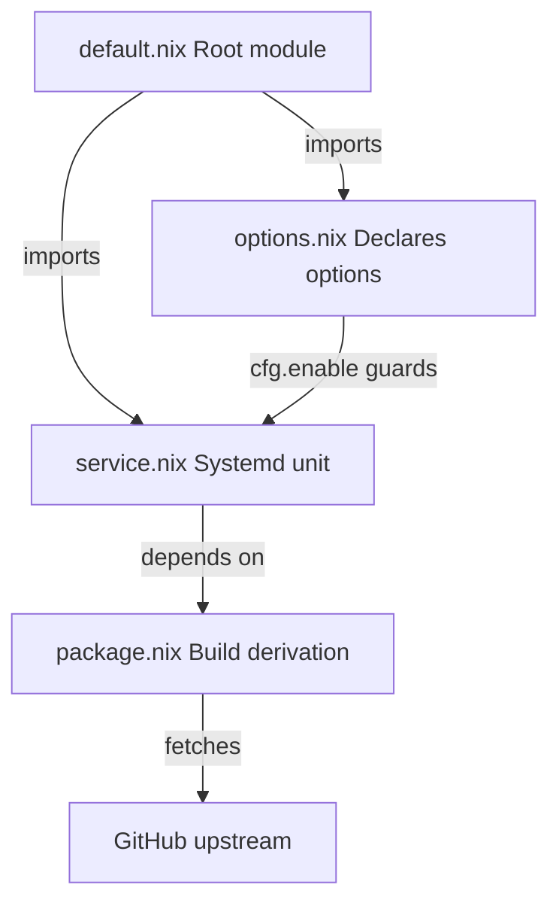
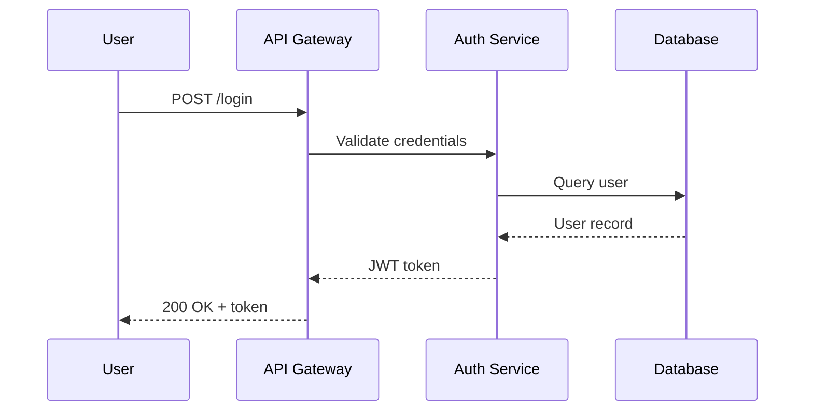

You have the **diagram** skill. After completing a task, a planning phase, or a significant edit, **ask the user** if they want a diagram of the changes. Never generate one without asking first.

## When to Offer

- After finishing a feature, refactor, or bug fix
- After completing a plan or design discussion
- After significant architectural changes
- When the user explicitly asks for a diagram

Always ask: "Want me to generate a diagram of these changes?"

## Diagram Type Auto-Detection

Choose the most appropriate Mermaid diagram type based on what was changed:

| Change type | Diagram type | Example |
|---|---|---|
| Module/service architecture | `C4Context` (mmdr) or `graph` (ascii) | New service, module restructuring |
| Algorithm/control flow | `graph` (ascii) or `flowchart` (mmdr) | Logic branching, pipeline steps |
| Object/data model | `classDiagram` | New types, schema changes |
| Request/interaction flow | `sequenceDiagram` | API calls, message passing |
| State transitions | `stateDiagram-v2` | Lifecycle changes, FSM |
| Test scenarios | `sequenceDiagram` | Test flow, mock interactions |
| Dependency graph | `flowchart` | Package deps, import chains |
| User journey / use case | `journey` | Feature walkthrough |
| Timeline / release plan | `timeline` | Phased rollout |
| Mixed / unclear | `flowchart` with labeled nodes | Default fallback |

## Scope

Diagram only what was changed or discussed in the **current session**. Do not map the entire project — focus on the user's contributions and their immediate context.

## Renderer Selection

Two renderers are available. Pick based on diagram complexity:

### Simple diagrams -> `mermaid-ascii` (terminal ASCII)

Use for:
- Flat flowcharts (no subgraphs)
- Sequence diagrams
- Any diagram with fewer than ~15 nodes

**IMPORTANT**: `mermaid-ascii` only parses `graph LR` / `graph TD` syntax correctly — NOT `flowchart`. Always use `graph` keyword when targeting this renderer. Edges must use spaces around arrows: `A --> B`, not `A-->B`.

### Complex diagrams -> `mmdr` (PNG via xdg-open)

Use for:
- C4 diagrams
- Class diagrams
- State diagrams
- Flowcharts with subgraphs
- Any diagram with 15+ nodes
- Any diagram type not supported by mermaid-ascii

## Workflow

1. **Generate** valid Mermaid code based on session changes
2. **Write** to `/tmp/claude-diagram.mmd`
3. **Render**:
   - Simple: `mermaid-ascii -f /tmp/claude-diagram.mmd`
   - Complex: `mmdr -i /tmp/claude-diagram.mmd -o /tmp/claude-diagram.png -e png && xdg-open /tmp/claude-diagram.png`

## Diagram Quality Guidelines

- **Human-readable**: Use clear, descriptive node labels (not IDs or hashes)
- **High-level**: Show the macro picture — modules, services, flows — not individual functions
- **Contextual**: Label edges with relationship types (calls, imports, triggers, returns)
- **Focused**: 5-20 nodes is ideal. If more are needed, split into multiple diagrams
- **Directional**: Use `LR` (left-to-right) for flows, `TD` (top-down) for hierarchies

## Example Output

For a session where a new NixOS module was created with options and a service:

For an API interaction flow:

