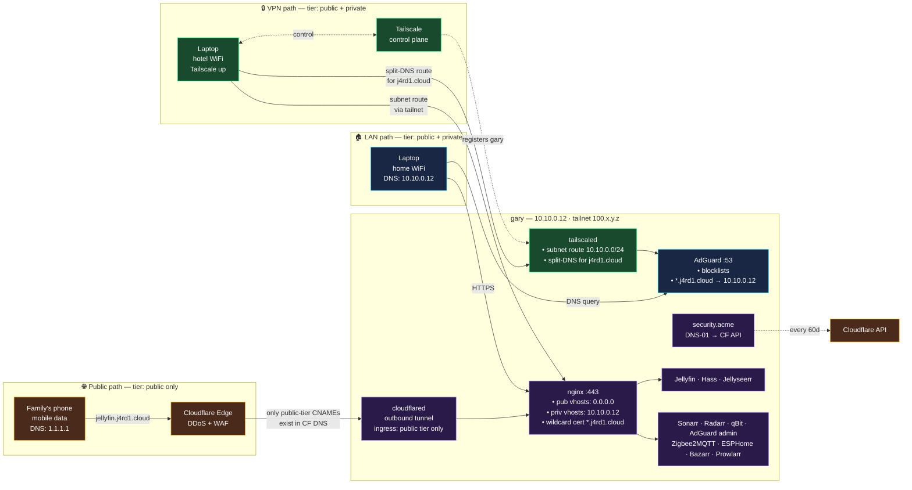

# Gary: networking layer — Plan

Status: proposed
Reads: [spec/gary-networking.md](../spec/gary-networking.md),
[memory/constitution.md](../memory/constitution.md)
Supersedes: [plan/gary-public-exposure.md](gary-public-exposure.md)

## 1. Architecture — three paths, one URL



## 2. The convergence trick

Why "same URL, three paths" is not fragile:

- **AdGuard's rewrite is unconditional** — it returns `10.10.0.12` for
  `*.j4rd1.cloud` regardless of which client asked. It doesn't need
  client-view logic.
- **Gary is a Tailscale subnet router** advertising `10.10.0.0/24`.
  Tailnet clients get a route to `10.10.0.12` through the tailnet.
- **Tailscale split-DNS** points `j4rd1.cloud` queries at gary's
  AdGuard IP (`10.10.0.12`) — reachable via the subnet route.
- **Nginx bindings** enforce the tier: private-tier vhosts bind to
  `10.10.0.12` only, so requests arriving via CF Tunnel (which
  proxies to `127.0.0.1:443`) never match a private vhost's
  server_name (nginx sees a request on the wrong listen address →
  default catch-all vhost → 404).
- **CF Tunnel ingress ACL** is a second belt: only public-tier
  hostnames have a routing rule; anything else gets `http_status:404`
  from cloudflared before even reaching nginx.

That's two independent gates for the tier boundary: nginx bind + CF
ingress rules. Removing either alone doesn't accidentally expose a
private service.

## 3. Tech choices

| Concern | Choice | Alt rejected because… |
|---|---|---|
| Cert issuance | `security.acme` (NixOS builtin, lego backend) | cert-manager — K8s-only |
| Cert scope | **Wildcard** `*.j4rd1.cloud` + apex SAN | Per-vhost — rate-limits + subdomain names leak in CT logs |
| ACME challenge | **DNS-01** via Cloudflare | HTTP-01 needs :80 open; TLS-ALPN needs :443 unwrapping through tunnel |
| LAN resolver | Existing `services.adguardhome` | Unbound, dnsmasq — no adblock UI |
| Split-horizon | AdGuard `filtering.rewrites` wildcard | dnsmasq --address — no adblock |
| **VPN backend** | **Tailscale** (`services.tailscale`) | Headscale — added ops burden; WireGuard — no MagicDNS + manual peer sync |
| Tailscale subnet advertisement | `services.tailscale.extraUpFlags = [ "--advertise-routes=10.10.0.0/24" ]` | Static WireGuard routes — same result more manual |
| Tailscale ACL / split-DNS | Managed via Tailscale admin (JSON), committable to git if using Headscale | Manual DNS config on each device — doesn't scale |
| **Public WAN backend** | **Cloudflare Tunnel** (`services.cloudflared`) | Port-forward — router config, CGNAT breaks it, no DDoS shield |
| Public WAN alternative | Port-forward feature flag (`portForward = true`) | (kept as an opt-in) |
| Public WAN alternative 2 | **Tailscale Funnel** — beta, 443 only, share via `tailscale funnel` | Feature-flagged experimental option; less mature than CF Tunnel |
| Reverse proxy | Existing `services.nginx` (refactor to always-on) | Caddy — nginx already wired |
| HSTS | 1yr `includeSubDomains`, **no preload** | Preload — one-way commit |

## 4. Dendritic module tree

```
modules/nixos.gary/
├── default.nix                      # host — imports by module attr name
├── secrets.nix                      # SOPS declarations
├── system/                          # existing modules relocated
│   ├── boot.nix
│   ├── hardware.nix
│   ├── home-manager.nix
│   ├── sleep.nix
│   ├── ssh.nix
│   └── users.nix
├── desktop/
│   ├── gaming.nix
│   └── gnome.nix
├── networking/                      # THIS SPEC
│   ├── acme.nix                     # existing — extend for wildcard
│   ├── adguard.nix                  # existing — no change
│   ├── reverse-proxy.nix            # existing — REFACTOR (drop !acme guard)
│   ├── split-horizon.nix            # NEW — AdGuard rewrites for j4rd1.cloud
│   ├── tailscale.nix                # NEW — tailscaled + subnet router
│   ├── cloudflared.nix              # NEW — CF Tunnel + ingress derivation
│   └── port-forward.nix             # NEW — alternative public WAN (opt-in)
├── media/
│   └── nixflix.nix
└── domotique/
    ├── home-assistant.nix
    ├── mosquitto.nix
    ├── zigbee2mqtt.nix
    ├── esphome.nix
    ├── matter-server.nix
    ├── bluetooth-hub.nix
    └── airplay/
```

Relocation is a pure `git mv` — `import-tree` scans recursively and
`default.nix` imports by module-attribute name
(`gary-<name>`), not by file path. Zero semantic change.

## 5. Feature flags & per-service tier

```nix
# modules/generic/gary.nix
featureFlags = {
  # existing…
  acme            = true;
  adguard         = true;
  # NEW:
  publicExposure  = true;    # master switch — turns on split-horizon + tunnel
  cloudflareTunnel = true;   # public WAN backend
  tailscale       = true;    # VPN backend
  portForward     = false;   # alternative public WAN — mutex with cloudflareTunnel
  tailscaleFunnel = false;   # alternative public WAN — Tailscale beta
};

# per-service tier
services.jellyfin.tier    = "public";
services.hass.tier        = "public";
services.jellyseerr.tier  = "public";
# everything else → lib.mkDefault "private"

# Mutex assertions
assertions = [
  {
    assertion = !(gary.featureFlags.cloudflareTunnel && gary.featureFlags.portForward);
    message = "gary: cloudflareTunnel and portForward are mutually exclusive";
  }
  {
    assertion = !(gary.featureFlags.cloudflareTunnel && gary.featureFlags.tailscaleFunnel);
    message = "gary: cloudflareTunnel and tailscaleFunnel are mutually exclusive (choose one public WAN)";
  }
  {
    assertion = gary.featureFlags.publicExposure -> (
      gary.featureFlags.cloudflareTunnel
      || gary.featureFlags.portForward
      || gary.featureFlags.tailscaleFunnel
    );
    message = "gary: publicExposure = true requires exactly one public WAN backend";
  }
];
```

## 6. ACME wildcard cert

```nix
# modules/nixos.gary/networking/acme.nix
security.acme = {
  acceptTerms = true;
  defaults = {
    email = gary.acme.email;
    dnsProvider = "cloudflare";
    credentialsFile = config.sops.secrets.acme-cloudflare-token.path;
    dnsPropagationCheck = true;
    reloadServices = [ "nginx.service" ];
  };

  certs."j4rd1.cloud" = {
    domain = "j4rd1.cloud";
    extraDomainNames = [ "*.j4rd1.cloud" ];
  };
};
```

## 7. Reverse-proxy refactor

Vhost builder becomes tier-aware:

```nix
# modules/nixos.gary/networking/reverse-proxy.nix
mkVirtualHost = _: svc:
  let
    isPublic = (svc.tier or "private") == "public";
  in {
    "${svc.subdomain}.${gary.domain.public}" = {
      # Public vhosts listen on 0.0.0.0 (reachable via CF Tunnel proxying
      # to 127.0.0.1:443). Private vhosts listen only on the LAN IP, so
      # a request arriving via CF Tunnel to a private vhost's Host header
      # never matches (falls through to the 404 default vhost).
      listenAddresses =
        if isPublic then [ "0.0.0.0" "[::]" ]
        else [ gary.network.lanIP ];

      forceSSL   = gary.featureFlags.acme;
      useACMEHost = if gary.featureFlags.acme then "j4rd1.cloud" else null;

      # 1-year HSTS on public tier only; private tier is LAN + tailnet,
      # HSTS is redundant.
      extraConfig = lib.optionalString isPublic ''
        add_header Strict-Transport-Security "max-age=31536000; includeSubDomains" always;
      '';

      locations."/" = {
        proxyPass = "http://127.0.0.1:${toString svc.port}";
        proxyWebsockets = true;
        extraConfig = ''
          proxy_set_header Host $host;
          proxy_set_header X-Real-IP $remote_addr;
          proxy_set_header X-Forwarded-For $proxy_add_x_forwarded_for;
          proxy_set_header X-Forwarded-Proto $scheme;
        '' + svc.extraNginxConfig;
      };
    };
  };
```

Drop the `lib.mkIf (!gary.featureFlags.acme)` guard — nginx runs
unconditionally when `publicExposure = true`.

Landing page vhost also binds `listenAddresses = [ gary.network.lanIP ];`
so `https://j4rd1.cloud/` bare from the internet doesn't leak the
service list.

## 8. Split-horizon rewrites

```nix
# modules/nixos.gary/networking/split-horizon.nix
{
  flake.modules.nixos.gary-split-horizon =
    { config, lib, ... }:
    let inherit (config.systemConstants) gary; in
    lib.mkIf (gary.featureFlags.adguard && gary.featureFlags.publicExposure) {
      services.adguardhome.settings.filtering.rewrites = lib.mkAfter [
        { domain = gary.domain.public;         answer = gary.network.lanIP; }
        { domain = "*.${gary.domain.public}";  answer = gary.network.lanIP; }
      ];
    };
}
```

## 9. Tailscale + subnet router

```nix
# modules/nixos.gary/networking/tailscale.nix
{
  flake.modules.nixos.gary-tailscale =
    { config, lib, pkgs, ... }:
    let inherit (config.systemConstants) gary; in
    lib.mkIf gary.featureFlags.tailscale {
      services.tailscale = {
        enable = true;
        # Pre-authenticated join with a reusable auth key. Node identity
        # persists across reboots via state stored in /var/lib/tailscale.
        authKeyFile = config.sops.secrets.tailscale-authkey.path;
        useRoutingFeatures = "server";       # kernel IP forwarding
        openFirewall = true;                  # udp/41641 for direct P2P

        extraUpFlags = [
          "--advertise-routes=${gary.network.lan.cidr}"
          "--advertise-tags=tag:server"
          "--accept-routes"
          "--accept-dns=false"                # gary uses AdGuard, not MagicDNS
          "--ssh"                             # optional: Tailscale SSH server
        ];
      };

      # Kernel IP forwarding for subnet-route feature (required per Tailscale docs)
      boot.kernel.sysctl = {
        "net.ipv4.ip_forward" = 1;
        "net.ipv6.conf.all.forwarding" = 1;
      };

      # Bind AdGuard to tailscale0 too so tailnet clients can query it
      # once the subnet route reaches them.
      services.adguardhome.settings.dns.bind_hosts = lib.mkForce [
        "0.0.0.0"  # LAN interface + tailscale0 (routing accepts subnet-src)
      ];
    };
}
```

On the Tailscale admin side (dashboard OR Headscale JSON committed to
repo), the ACL must:

1. Auto-approve gary's advertised route `10.10.0.0/24`
2. Set split-DNS for `j4rd1.cloud` → nameserver `10.10.0.12`
3. Grant tailnet users `tag:server` access to `10.10.0.0/24:443`

Minimal ACL fragment:

```jsonc
{
  "tagOwners": { "tag:server": ["autogroup:admin"] },
  "acls": [
    { "action": "accept", "src": ["autogroup:member"], "dst": ["tag:server:*"] },
    { "action": "accept", "src": ["autogroup:member"], "dst": ["10.10.0.0/24:*"] }
  ],
  "autoApprovers": {
    "routes": { "10.10.0.0/24": ["tag:server"] }
  },
  "dns": {
    "domains": ["j4rd1.cloud"],
    "nameservers": ["10.10.0.12"]
  }
}
```

Commit as `modules/nixos.gary/networking/tailscale-policy.hujson` if
migrating to Headscale later.

## 10. Cloudflare Tunnel (public WAN)

```nix
# modules/nixos.gary/networking/cloudflared.nix
{
  flake.modules.nixos.gary-cloudflared =
    { config, lib, ... }:
    let
      inherit (config.systemConstants) gary;
      publicSvcs = lib.filterAttrs
        (_: svc: svc.enable && (svc.tier or "private") == "public")
        gary.services;
    in
    lib.mkIf (gary.featureFlags.publicExposure && gary.featureFlags.cloudflareTunnel) {
      services.cloudflared = {
        enable = true;
        tunnels."${gary.cloudflareTunnel.uuid}" = {
          credentialsFile = config.sops.secrets.cloudflared-credentials.path;

          ingress = lib.mapAttrs' (_: svc:
            lib.nameValuePair "${svc.subdomain}.${gary.domain.public}" {
              service = "https://127.0.0.1:443";
              originRequest = {
                # Nginx serves a valid cert for the request's Host — no verify skip.
                noTLSVerify = false;
                httpHostHeader = "${svc.subdomain}.${gary.domain.public}";
              };
            }
          ) publicSvcs;

          # Catch-all: anything not in the allowlist gets 404 before nginx.
          default = "http_status:404";
        };
      };
    };
}
```

Ingress is **derived** from `gary.services` where `tier = "public"`
— single source of truth. Flipping a service's tier changes both the
nginx bind AND the CF ingress rule in one commit.

## 11. Port-forward alternative

```nix
# modules/nixos.gary/networking/port-forward.nix
{
  flake.modules.nixos.gary-port-forward =
    { config, lib, ... }:
    let inherit (config.systemConstants) gary; in
    lib.mkIf (gary.featureFlags.publicExposure && gary.featureFlags.portForward) {
      networking.firewall.allowedTCPPorts = [ 80 443 ];

      # Nginx listens 0.0.0.0 by default when tier=public — no extra config.
      # User must set the router to forward :80 and :443 to gary.network.lanIP.
      # If public IP changes, user must update the CF A record for
      # each public-tier subdomain (or use a DDNS client, out of scope).
    };
}
```

## 12. HA awareness

`services.home-assistant.config.homeassistant`:

```nix
external_url = "https://hass.${gary.domain.public}";
internal_url = "https://hass.${gary.domain.public}";
```

Same URL for both is correct — split-horizon makes it work.

Add `cert_expiry` to `extraComponents` + a sensor + an automation
pinging on <14 days remaining. (Detail in
[plan/gary-media-domotique.md](gary-media-domotique.md) §7.)

## 13. Deployment sequence

Layered, each reversible with `xi rollback`:

| Stage | Content | Depends on |
|---|---|---|
| **N0** | `git mv` — relocate existing modules into `system/networking/desktop/media/domotique/` subdirs. Pure rename. | none |
| **N1** | `reverse-proxy.nix` refactor: unconditional nginx; tier-aware bind; landing page LAN-only | N0 |
| **N2** | ACME wildcard cert (`security.acme.certs."j4rd1.cloud"`); SOPS `acme-cloudflare-token` | N1 |
| **N3** | `split-horizon.nix`; retire `domain.local` in favour of `domain.public` | N2 |
| **N4** | `tailscale.nix`; SOPS `tailscale-authkey`; ACL configured in Tailscale admin | N2 (needs cert for tailnet clients too) |
| **N5** | `cloudflared.nix`; SOPS `cloudflared-credentials`; per-service `tier = "public"` flip; CF DNS per-service CNAMEs | N3 + N4 (both DNS paths must work first) |
| **N6** | `port-forward.nix` — feature-flag off by default | N1 |

## 14. Validation matrix

After each stage, three tests corresponding to the three paths:

```bash
# --- LAN ---
dig +short jellyfin.j4rd1.cloud @10.10.0.12          # → 10.10.0.12
curl -sSf https://jellyfin.j4rd1.cloud/health        # → 200
openssl s_client -showcerts -connect jellyfin.j4rd1.cloud:443 </dev/null 2>/dev/null | openssl x509 -noout -fingerprint

# --- Tailnet (from a tailnet peer) ---
tailscale ping gary                                   # direct or via DERP
tailscale status | grep 10.10.0.0/24                  # subnet route accepted
dig +short jellyfin.j4rd1.cloud                       # → 10.10.0.12 (via split-DNS)
curl -sSf https://jellyfin.j4rd1.cloud/health         # → 200

# --- Public (from mobile data, tailscale down) ---
dig +short jellyfin.j4rd1.cloud @1.1.1.1              # → CF edge IP
curl -sSf https://jellyfin.j4rd1.cloud/health         # → 200
curl -sSf https://sonarr.j4rd1.cloud/ ; echo $?       # → non-zero (NXDOMAIN or refused)

# --- Fingerprints must all match ---
```

## 15. Risks

| Risk | Mitigation |
|---|---|
| Tailscale control plane outage → no new device auth | Existing tailnet keeps working (control plane is only for auth + key exchange); Headscale switch documented as escape hatch |
| Split-DNS misconfigured in tailnet → laptop resolves via public → hits CF Tunnel → 404 for private tier | Test path 2 of the validation matrix on every stage; document in the ACL comment |
| Wildcard cert compromised = whole domain compromised | Accepted trade-off vs. per-vhost CT leaks; rotate LE account key + re-issue if compromise suspected |
| CF sees plaintext at edge | Documented trade-off; migration path to CF "no-TLS-terminate" ingress + client-cert chain is a future spec |
| Subnet router advertises 10.10.0.0/24 but ACL doesn't approve → tailnet clients can't reach 10.10.0.12 | Auto-approver rule in ACL (§9); verified with `tailscale status` |
| Tailscale kernel IP-forwarding sysctl leaks other subnets | `useRoutingFeatures = "server"` scoping + explicit `advertise-routes`; no other interfaces routed |
| AdGuard bound to `0.0.0.0` exposes DNS on tailnet without ACL | Add `firewall.interfaces.tailscale0.allowedUDPPorts = [ 53 ]` explicitly and NOT via `0.0.0.0` firewall opening |
| Port-forward + Tailscale both on → confusion about which serves external | Mutex assertion (§5) |
| LE issues bogus cert during setup (bug/staging) | `useStaging = true` for first successful renewal round-trip, then flip off |
| Nginx default vhost catches unexpected requests → info leak | Default vhost serves `return 444;` (nginx-specific: close connection without response) |
| HA external_url != public_url → mobile app confused | Set both `internal_url` and `external_url` to the SAME public URL; split-horizon makes it work |

## 16. Constants additions (public — safe in the repo)

```nix
# modules/generic/gary.nix
network = {
  # existing…
  lan.cidr = "10.10.0.0/24";  # NEW — used by tailscale --advertise-routes
};

# Remove `domain.local` (unused after N3). Keep only:
domain = {
  public = "j4rd1.cloud";
};
```

**Not** in the constants: `cloudflareTunnel.uuid`, tailscale tailnet
name, ACME token, tunnel credentials. Those go through SOPS (see §17)
and are read at activation time — never persisted in `/nix/store`,
never grep-able in the repo.

## 17. Secrets — sops-nix, because the repo is public

`Dauliac/dotfiles` is a **public GitHub repo**. Every value that could
grant access, identify a private endpoint, or embarrass the user if
grepped goes through `sops-nix`. The encrypted YAML/JSON files
(`*.enc.yaml`) are the only secret-bearing artifacts allowed to enter
git.

### Sensitivity map

| Value | In SOPS as | Consumed as |
|---|---|---|
| CF API token (Zone.DNS:Edit on j4rd1.cloud) | `acme-cloudflare-token` | `config.sops.secrets.acme-cloudflare-token.path` in `security.acme.defaults.credentialsFile` |
| CF Tunnel credentials JSON | `cloudflared-credentials` | `services.cloudflared.tunnels.<uuid>.credentialsFile` |
| CF Tunnel UUID | `cloudflared-tunnel-uuid` | Rendered via `sops.templates` into a systemd env file consumed by cloudflared (see §17.2) |
| Tailscale pre-auth key | `tailscale-authkey` | `services.tailscale.authKeyFile` |
| Tailscale tailnet name | `tailscale-tailnet` | Rendered into HA config via `sops.templates` if needed |
| MQTT broker passwords (×3) | `mqtt-{homeassistant,zigbee2mqtt,esphome}-password` | mosquitto `passwordFile` (existing) |
| HA `!secret mqtt_password` | Rendered via `sops.templates."hass-secrets.yaml"` | HA reads `/var/lib/hass/secrets.yaml` (existing) |
| Zigbee2MQTT frontend token | `zigbee2mqtt-frontend-token` | z2m `frontend.auth_token` via `!` prefix (existing) |
| Jellyfin admin password | `jellyfin-admin-password` | nixflix (existing) |
| Arr API keys (Sonarr/Radarr/Lidarr/Prowlarr/Jellyseerr) | `<svc>-api-key` | nixflix (existing) |
| WireGuard config for nixflix.vpn | `wireguard-mullvad-conf` | nixflix.vpn `wgConfFile` (existing) |
| TMDB API key for Hassarr | `hassarr-tmdb-api-key` | Rendered into a Hassarr config file via `sops.templates` |
| User hashed passwords (gary, dauliac) | `<user>_hashed_password` | `users.users.<user>.hashedPasswordFile` (existing) |

### 17.1 Node-level SOPS setup

```nix
# modules/nixos.gary/secrets.nix (extended)
{
  sops = {
    # Age recipient keys — gary's host key is derived from its SSH host key
    # (see sops-nix docs). No plaintext key in the repo.
    age = {
      sshKeyPaths = [ "/etc/ssh/ssh_host_ed25519_key" ];
      keyFile = "/var/lib/sops-nix/keys.txt";  # generated at activation
      generateKey = false;                       # host key is authoritative
    };

    # All secret files live under secrets/ in the repo, encrypted with
    # both the gary host key and dauliac's personal age public key.
    defaultSopsFile = ../../secrets/gary.enc.yaml;

    secrets = {
      # ACME + CF Tunnel + Tailscale
      acme-cloudflare-token   = { mode = "0400"; };
      cloudflared-credentials = lib.mkIf gary.featureFlags.cloudflareTunnel {
        owner = "cloudflared"; group = "cloudflared"; mode = "0400";
      };
      cloudflared-tunnel-uuid = lib.mkIf gary.featureFlags.cloudflareTunnel {
        mode = "0400";
      };
      tailscale-authkey  = lib.mkIf gary.featureFlags.tailscale { mode = "0400"; };
      tailscale-tailnet  = lib.mkIf gary.featureFlags.tailscale { mode = "0400"; };

      # (existing arr / mqtt / jellyfin secrets omitted for brevity — no change)
    };
  };
}
```

### 17.2 Templated secrets — for values that must appear inside a config file

Some tools want secret data interpolated inline (systemd env files,
YAML configs). `sops.templates` renders a real file at
activation time, resolving `${config.sops.placeholder.<name>}` to the
plaintext of the given secret, with the same ownership + mode
guarantees.

**cloudflared** — the tunnel UUID isn't a systemd arg, it's part of
the config attribute name. Nixflix's approach doesn't apply here.
Instead, keep the UUID in SOPS and render a tiny json fragment
alongside the credentials file that cloudflared reads:

```nix
sops.templates."cloudflared-tunnel-uuid.env" = lib.mkIf gary.featureFlags.cloudflareTunnel {
  owner = "cloudflared";
  group = "cloudflared";
  mode = "0400";
  content = ''
    TUNNEL_UUID=${config.sops.placeholder.cloudflared-tunnel-uuid}
  '';
};

# Then, in cloudflared.nix, use the env file rather than hardcoding the
# UUID in the nix source:
systemd.services.cloudflared-tunnel-generated.serviceConfig.EnvironmentFile =
  config.sops.templates."cloudflared-tunnel-uuid.env".path;
```

Alternative simpler path if the `services.cloudflared` module requires
the UUID at nix-eval time (attribute key): keep the UUID in a
**gitignored** local file `hosts/gary/tunnel.uuid` and read it via
`builtins.readFile ./tunnel.uuid`. That keeps it out of git without
requiring runtime template rendering. Pick this if the module can't be
persuaded to accept a runtime env-var override.

**Hassarr TMDB key** — Hassarr wants the key in its YAML config:

```nix
sops.templates."hassarr-config.yaml" = lib.mkIf gary.featureFlags.haArrIntegration {
  owner = "hass";
  group = "hass";
  mode = "0400";
  path = "/var/lib/hass/custom_components/hassarr/config.yaml";
  content = ''
    tmdb_api_key: ${config.sops.placeholder.hassarr-tmdb-api-key}
  '';
};
```

### 17.3 Encrypted file layout

```
secrets/
├── passwords/
│   ├── gary.enc.json          # existing — gary_hashed_password
│   └── dauliac.enc.json       # existing — dauliac_hashed_password
├── gary.enc.yaml              # NEW — all gary-scoped secrets in one file
└── .sops.yaml                 # age-recipient policy (public)
```

`.sops.yaml` recipient policy — public, ships in git:

```yaml
keys:
  - &gary_host age1abcdef…             # gary's host age key (derived from ssh_host_ed25519_key)
  - &dauliac_user age1ghijkl…          # dauliac's personal key on his laptop
creation_rules:
  - path_regex: secrets/gary\.enc\.yaml$
    key_groups:
      - age:
          - *gary_host
          - *dauliac_user
  - path_regex: secrets/passwords/.*\.enc\.json$
    key_groups:
      - age:
          - *gary_host
          - *dauliac_user
```

Both recipients can decrypt; either alone can rotate.

### 17.4 Pre-commit safety net

Add a git-hook to `git-hooks.nix` (already an input):

```nix
# modules/checks/no-plaintext-secrets.nix (NEW)
{
  perSystem = { pkgs, ... }: {
    pre-commit.settings.hooks.no-plaintext-secrets = {
      enable = true;
      name = "no plaintext secrets";
      entry = "${pkgs.writeShellScript "grep-secrets" ''
        if git diff --cached | grep -iqE '(BEGIN [A-Z ]*PRIVATE KEY|xox[baprs]-|AKIA[0-9A-Z]{16}|ghp_[0-9a-zA-Z]{36}|CFP_[0-9a-zA-Z_]+|tskey-[a-z0-9-]+)'; then
          echo "❌ possible plaintext secret in staged diff — commit blocked"
          exit 1
        fi
      ''}";
      language = "system";
      pass_filenames = false;
    };
  };
}
```

Regex list covers: PEM blocks, Slack tokens, AWS keys, GitHub PATs, CF
Origin tokens, Tailscale keys. Extend as new secret shapes appear.
Runs on every `git commit` before the change hits the tree.

### 17.5 Runtime verification

After every deploy:

```bash
# Confirm none of the expected secrets rendered as literals in the store
for name in acme-cloudflare-token tailscale-authkey cloudflared-credentials; do
  if grep -RIF "$(sops -d --extract "[\"$name\"]" secrets/gary.enc.yaml 2>/dev/null)" /nix/store 2>/dev/null; then
    echo "❌ $name leaked into /nix/store"
  fi
done
```

Expected: no output.

## 18. Beads decomposition

Run when `bd` is available (agent sandbox blocks it mid-session; use
`! bd ...` bypass):

```bash
NET=$(bd create --title="gary: networking layer — split-horizon + CF Tunnel + Tailscale" \
                 --type=feature --priority=medium \
                 --description="Implements spec/gary-networking.md")

N0=$(bd q "gary: relocate existing modules into system/networking/desktop/media/domotique subdirs (git mv only)" --priority high)
N1=$(bd q "gary: reverse-proxy.nix refactor — unconditional nginx, tier-aware bind, landing page LAN-only" --priority high)
N2a=$(bd q "gary: SOPS acme-cloudflare-token secret" --priority high)
N2b=$(bd q "gary: security.acme wildcard cert for j4rd1.cloud" --priority high)
N3a=$(bd q "gary: retire domain.local — remove from constants, update refs" --priority medium)
N3b=$(bd q "gary: networking/split-horizon.nix — AdGuard rewrites" --priority high)
N4a=$(bd q "gary: SOPS tailscale-authkey secret" --priority medium)
N4b=$(bd q "gary: networking/tailscale.nix — service + subnet router" --priority medium)
N4c=$(bd q "gary: Tailscale ACL — auto-approve subnet, split-DNS j4rd1.cloud" --priority medium)
N5a=$(bd q "gary: SOPS cloudflared-credentials secret" --priority medium)
N5b=$(bd q "gary: networking/cloudflared.nix — CF Tunnel + ingress from tier=public" --priority medium)
N5c=$(bd q "gary: services.<name>.tier = public for jellyfin/hass/jellyseerr" --priority medium)
N5d=$(bd q "gary: CF DNS per-public-service CNAMEs (not wildcard)" --priority medium)
N5e=$(bd q "gary: HA external_url + cert_expiry sensor + <14d automation" --priority low)
N6=$(bd q "gary: networking/port-forward.nix — alternative WAN (opt-in)" --priority low)

# Fan-in
bd link $NET $N0 $N1 $N2a $N2b $N3a $N3b $N4a $N4b $N4c $N5a $N5b $N5c $N5d $N5e $N6

# Ordering
bd link $N1 $N0
bd link $N2b $N2a
bd link $N2b $N1
bd link $N3a $N2b
bd link $N3b $N2b
bd link $N4b $N4a
bd link $N4b $N2b
bd link $N4c $N4b
bd link $N5b $N5a
bd link $N5b $N3b
bd link $N5b $N4b
bd link $N5c $N5b
bd link $N5d $N5b
bd link $N5e $N5b
bd link $N6 $N1

# Cross-spec
bd link $NET dotfiles-w60   # HA foundation
bd link $NET dotfiles-5xj   # media stack

# Supersede the earlier public-exposure decomposition
# (its beads $PE and $P* were never created — the plan doc is now
# marked as superseded by this one)
```

## 19. Explicit non-inclusions

- **Zero-trust auth proxy** (Authelia, Authentik, CF Access) — services
  use native auth; separate spec if admin SSO wanted.
- **DoH/DoT server on gary** offering DoH to LAN devices — AdGuard
  supports it, add later if a client needs it.
- **IPv6-only path** — dual-stack handled transparently by CF + Tailscale.
- **Multi-site tailnet mesh** — single-user tailnet only.
- **Ephemeral tailnet keys / OAuth clients** — feature-flag static
  auth key for now; can migrate to OAuth clients later.
