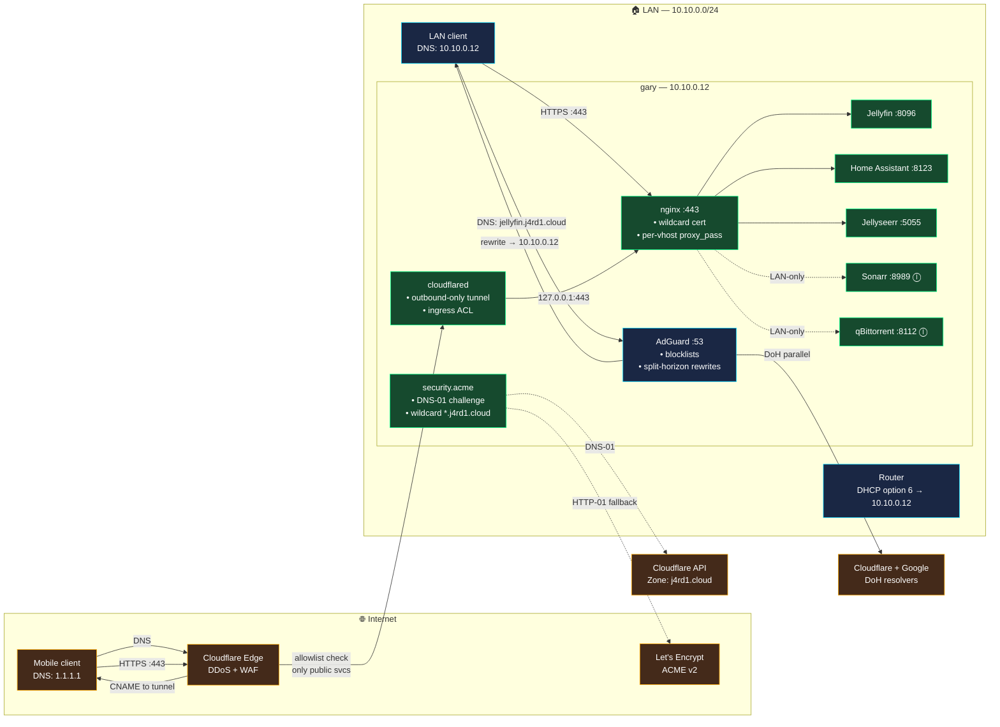

# Gary: public exposure with split-horizon DNS — Plan

> **⚠️ SUPERSEDED** by [gary-networking.md](gary-networking.md).
> That plan absorbs everything here (wildcard cert, split-horizon,
> CF Tunnel) plus a Tailscale VPN tier, a per-service tier flag, and
> a dedicated SOPS section for the public-repo case.
> Keep this file as history; do not extend.

Status: superseded 2026-08-01
Reads: [spec/gary-public-exposure.md](../spec/gary-public-exposure.md),
[memory/constitution.md](../memory/constitution.md)

## 1. Architecture at a glance



**ⓛ** = LAN-only, no CF Tunnel ingress route.

## 2. Tech choices

| Concern | Choice | Alternative rejected because… |
|---|---|---|
| ACME client | `security.acme` (NixOS built-in, lego backend) | cert-manager — K8s-only; installing k3s just for cert-manager is overkill |
| Cert scope | **Wildcard** `*.j4rd1.cloud` + `j4rd1.cloud` SAN | Per-vhost — hits LE 50-cert/week rate limit on subdomain churn |
| ACME challenge | **DNS-01** via Cloudflare API | HTTP-01 — needs port 80 open, breaks with CF Tunnel; TLS-ALPN-01 — needs port 443 open through the tunnel unwrap layer |
| DNS provider | Cloudflare (already `acme.dnsProvider = "cloudflare"`) | Route53, Google — more moving parts, no reason to switch |
| Public DNS resolver hit by external clients | Cloudflare authoritative for `j4rd1.cloud` | Any authoritative DNS works; CF is already the zone |
| LAN DNS resolver | Existing AdGuard (`services.adguardhome`) | Unbound — no adblock; dnsmasq — no adblock UI |
| Split-horizon mechanism | AdGuard `filtering.rewrites` with wildcard `*.j4rd1.cloud` | dnsmasq --address — no adblock; local zone file — hard to change |
| WAN transport (default) | **Cloudflare Tunnel** (`services.cloudflared`) | Port-forward — needs router config, breaks on CGNAT, no DDoS shield |
| WAN transport (alternative) | Port-forward 80/443, exposed via feature flag | (see above; kept as opt-in for full self-host purity) |
| Reverse proxy | Existing `services.nginx` (refactored to always run) | Caddy — nginx already wired for `recommendedProxySettings` etc. |
| Landing page scope | LAN-only vhost binding to `gary.network.lanIP` | Public — leaks internal service inventory to fingerprinters |
| HSTS | 1-year `includeSubDomains`, no preload | Preload — one-way commitment, hard to reverse for a personal domain |

## 3. Module tree (dendritic reorganization)

Current layout is flat under `modules/nixos.gary/`. This plan **relocates**
files by concern. Since dendritic module attribute names
(`gary-<name>`) don't depend on file paths, and `import-tree` scans
recursively, `default.nix` imports stay unchanged.

```
modules/nixos.gary/
├── default.nix                      # host — unchanged
├── secrets.nix                      # SOPS declarations
├── system/                          # NEW subdir
│   ├── boot.nix                     # was: boot.nix
│   ├── hardware.nix                 # was: hardware.nix
│   ├── home-manager.nix             # was: home-manager.nix
│   ├── sleep.nix                    # was: sleep.nix
│   ├── ssh.nix                      # was: ssh.nix
│   └── users.nix                    # was: users.nix
├── desktop/                         # NEW subdir
│   ├── gaming.nix                   # was: gaming.nix
│   └── gnome.nix                    # was: gnome.nix
├── networking/                      # NEW subdir
│   ├── acme.nix                     # was: acme.nix — extend for wildcard
│   ├── adguard.nix                  # was: adguard.nix — no code change
│   ├── reverse-proxy.nix            # was: reverse-proxy.nix — REFACTOR
│   ├── split-horizon.nix            # NEW — AdGuard public-domain rewrites
│   ├── cloudflared.nix              # NEW — CF Tunnel
│   └── port-forward.nix             # NEW — alternative WAN
├── media/                           # NEW subdir
│   └── nixflix.nix                  # was: nixflix.nix
└── domotique/                       # NEW subdir
    ├── home-assistant.nix           # was: home-assistant.nix
    ├── mosquitto.nix                # was: mosquitto.nix
    ├── zigbee2mqtt.nix              # was: zigbee2mqtt.nix
    ├── esphome.nix                  # was: esphome.nix
    ├── matter-server.nix            # was: matter-server.nix
    ├── bluetooth-hub.nix            # was: bluetooth-hub.nix
    └── airplay/                     # was: airplay/
```

**Delivery constraint** — agent sandbox can't `git mv`. Approach:

1. Create the NEW public-exposure modules directly in the new tree
   (`networking/split-horizon.nix`, `networking/cloudflared.nix`,
   `networking/port-forward.nix`).
2. Leave existing files where they are.
3. Add a Stage-P0 bead: "relocate existing gary modules into
   system/, networking/, desktop/, media/, domotique/ subdirs via
   `git mv` in one atomic commit". User runs the moves; module
   attribute names don't change, `default.nix` unchanged, no build
   breakage.

The dendritic invariant: each `.nix` file declares exactly one
`flake.modules.nixos.gary-<name>` and is self-contained. Subdirs are
organizational only.

## 4. Split-horizon flow, step by step

Take `laptop → jellyfin.j4rd1.cloud` on the LAN:

1. Laptop's resolver (from DHCP) is `10.10.0.12`.
2. Laptop sends `A jellyfin.j4rd1.cloud` to AdGuard on gary.
3. AdGuard matches its `filtering.rewrites` entry
   `*.j4rd1.cloud → 10.10.0.12`. Returns immediately, no upstream
   query, no blocklist check (the rewrite short-circuits).
4. Laptop opens TCP :443 to `10.10.0.12`.
5. Nginx SNI-routes to the Jellyfin vhost.
6. Nginx presents `/var/lib/acme/j4rd1.cloud/fullchain.pem` — valid
   LE wildcard.
7. Nginx `proxy_pass http://127.0.0.1:8096`.

Same URL, off-LAN:

1. Phone resolver is `1.1.1.1` (or ISP).
2. Query returns CF authoritative answer: CNAME to
   `<tunnel-uuid>.cfargotunnel.com` → A/AAAA to CF edge.
3. Phone opens HTTPS to CF edge.
4. CF edge terminates outer TLS (Cloudflare cert, transparent to user),
   consults tunnel ingress ACL, routes to gary's `cloudflared` over the
   outbound tunnel session.
5. `cloudflared` re-encrypts to `https://127.0.0.1:443` — the local
   nginx, using the LE cert. (Or plain `http://127.0.0.1:80` with
   HSTS forcing 443 — see §7.)
6. Nginx SNI-routes as before.
7. Response follows the reverse path.

## 5. ACME wildcard cert setup

```nix
# modules/nixos.gary/networking/acme.nix (extended)
security.acme = {
  acceptTerms = true;
  defaults = {
    email = gary.acme.email;
    dnsProvider = "cloudflare";
    credentialsFile = config.sops.secrets.acme-cloudflare-token.path;
    # Wait 30s for DNS propagation before asking LE to verify.
    dnsPropagationCheck = true;
    reloadServices = [ "nginx.service" ];
  };

  certs."j4rd1.cloud" = {
    domain = "j4rd1.cloud";
    extraDomainNames = [ "*.j4rd1.cloud" ];
    # Renewed every 60 days, cert lasts 90 days.
  };
};
```

Every vhost then uses `useACMEHost = "j4rd1.cloud"; forceSSL = true;`
and inherits the shared cert.

## 6. Reverse-proxy refactor

Current `reverse-proxy.nix` is guarded by `lib.mkIf (!gary.featureFlags.acme)`
— nginx runs **only when ACME is off**. That's inverted. Fix:

- Drop the `!acme` guard. Nginx runs whenever `publicExposure = true`
  OR `acme = true` (essentially, always in production).
- Vhost builder becomes ACME-aware:

```nix
mkVirtualHost = _: svc: {
  "${svc.subdomain}.${gary.domain.public}" = lib.recursiveUpdate
    {
      # LAN-only vhosts bind to the LAN interface only
      listenAddresses =
        if svc.exposePublicly or false then [ "0.0.0.0" "::" ]
        else [ gary.network.lanIP "127.0.0.1" ];

      forceSSL = gary.featureFlags.acme;
      useACMEHost = if gary.featureFlags.acme then "j4rd1.cloud" else null;

      locations."/" = {
        proxyPass = "http://127.0.0.1:${toString svc.port}";
        proxyWebsockets = true;
        extraConfig = ''
          proxy_set_header Host $host;
          proxy_set_header X-Real-IP $remote_addr;
          proxy_set_header X-Forwarded-For $proxy_add_x_forwarded_for;
          proxy_set_header X-Forwarded-Proto $scheme;
        '' + svc.extraNginxConfig;
      };
    }
    (svc.extraVhostConfig or { });
};
```

Landing page vhost also gets `listenAddresses = [ gary.network.lanIP ];`
so `https://j4rd1.cloud/` bare from the internet doesn't leak the
service list.

## 7. Cloudflare Tunnel (`cloudflared`)

```nix
# modules/nixos.gary/networking/cloudflared.nix (NEW)
services.cloudflared = {
  enable = true;
  tunnels."${gary.cloudflareTunnel.uuid}" = {
    credentialsFile = config.sops.secrets.cloudflared-credentials.path;

    # Route ONLY the public-allowlisted services. Anything else falls
    # through to the 404 catch-all — belt-and-braces on top of nginx's
    # listenAddresses check.
    ingress = lib.mapAttrs' (name: svc:
      lib.nameValuePair "${svc.subdomain}.${gary.domain.public}" {
        service = "https://localhost:443";
        originRequest = {
          # Local nginx cert is valid for the public name — no verify skip needed.
          noTLSVerify = false;
          httpHostHeader = "${svc.subdomain}.${gary.domain.public}";
        };
      }
    ) (lib.filterAttrs (_: svc: svc.enable && (svc.exposePublicly or false))
                       gary.services);

    default = "http_status:404";
  };
};
```

Ingress is **derived from the services attrset** — the source of truth
for "what's exposed" stays in one place (`gary.nix`). Adding a new
public service = flip `exposePublicly = true`.

## 8. Split-horizon rewrites (`split-horizon.nix`)

```nix
# modules/nixos.gary/networking/split-horizon.nix (NEW)
{
  flake.modules.nixos.gary-split-horizon =
    { config, lib, ... }:
    let inherit (config.systemConstants) gary; in
    lib.mkIf (gary.featureFlags.adguard && gary.featureFlags.publicExposure) {
      services.adguardhome.settings.filtering.rewrites = lib.mkAfter [
        {
          domain = gary.domain.public;
          answer = gary.network.lanIP;
        }
        {
          domain = "*.${gary.domain.public}";
          answer = gary.network.lanIP;
        }
      ];
    };
}
```

`lib.mkAfter` because the existing `adguard.nix` block (or the LAN-only
`reverse-proxy.nix` when `!acme`) may already have rewrites — we
append, don't replace.

## 9. Feature flags added

```nix
# modules/generic/gary.nix additions
featureFlags = {
  # existing…
  publicExposure   = true;    # split-horizon + WAN routing on
  cloudflareTunnel = true;    # WAN via CF Tunnel (else port-forward)
  portForward      = false;   # alternative WAN — flip this + turn cloudflareTunnel off
};

# per-service allowlist
services.jellyfin.exposePublicly    = true;
services.jellyseerr.exposePublicly  = true;
services.hass.exposePublicly        = true;
# everything else defaults to false via lib.mkDefault in the shared shape
```

`cloudflareTunnel` and `portForward` are **mutually exclusive** —
enforced with an assertion:

```nix
assertions = [{
  assertion = !(gary.featureFlags.cloudflareTunnel && gary.featureFlags.portForward);
  message = "gary: cloudflareTunnel and portForward are mutually exclusive WAN modes";
}];
```

## 10. Constants additions

```nix
# modules/generic/gary.nix
cloudflareTunnel = {
  # Populated after `cloudflared tunnel create gary`
  uuid = "REPLACE-ME-WITH-TUNNEL-UUID";
};

hsts = {
  maxAge = 31536000;  # 1 year
  includeSubDomains = true;
  preload = false;    # never preload personal domains
};
```

## 11. Deployment sequence

Layered rollout, each stage independently reversible with `xi rollback`:

| Stage | Content | Diff est. | Depends on |
|---|---|---|---|
| **P0** | Move existing modules into `system/`, `networking/`, `desktop/`, `media/`, `domotique/` subdirs via `git mv` — pure relocation, zero semantic change | 0 (rename-only) | none |
| **P1** | Refactor `reverse-proxy.nix`: unconditional nginx; ACME-aware vhosts; landing page bound to LAN interface | ~80 lines | P0 |
| **P2** | ACME wildcard cert (`security.acme.certs."j4rd1.cloud"`); Cloudflare API token in SOPS | ~40 lines | P1 |
| **P3** | Split-horizon rewrites (`split-horizon.nix`); flip `domain.public` on services | ~30 lines | P2 |
| **P4** | Cloudflare Tunnel (`cloudflared.nix`); per-service `exposePublicly` flag; SOPS tunnel credentials | ~120 lines | P3, tunnel created in CF dash |
| **P5** | Port-forward alternative (`port-forward.nix`) — feature-flag off by default | ~40 lines | P4 |

## 12. Validation between stages

```bash
nix flake check
nix build .#nixosConfigurations.gary.config.system.build.toplevel

# After P1:
curl -Ik https://jellyfin.j4rd1.cloud   # LAN, expect self-signed
# After P2:
sudo openssl x509 -in /var/lib/acme/j4rd1.cloud/fullchain.pem -noout -issuer -subject -dates
curl -I https://jellyfin.j4rd1.cloud    # LAN, expect valid LE cert
# After P3:
dig +short jellyfin.j4rd1.cloud @10.10.0.12  # expect 10.10.0.12
dig +short jellyfin.j4rd1.cloud @1.1.1.1     # expect CF edge / tunnel CNAME
# After P4:
# On mobile data, off LAN:
curl -I https://jellyfin.j4rd1.cloud    # 200
curl -I https://sonarr.j4rd1.cloud      # connection refused / 404
systemctl status cloudflared             # active
```

## 13. Rollback

Each stage is one commit. `xi rollback` reverts atomically:

- P4 rollback → cloudflared stops → external clients fail; LAN
  unaffected.
- P3 rollback → AdGuard drops the rewrites → LAN clients hit CF
  authoritative and route via tunnel (still works, just slower);
  cert stays valid.
- P2 rollback → cert expires in ≤90 days but existing cert on disk keeps
  working until then.
- P1 rollback → back to `!acme` guard; nginx off; LAN reachability
  requires direct IP:port until re-deployed.

## 14. Risks

| Risk | Mitigation |
|---|---|
| CF token leaked → DNS zone compromise | Scope token to `j4rd1.cloud` only, `Zone.DNS:Edit` + `Zone.Zone:Read`; rotate via CF dashboard; stored in SOPS |
| Tunnel token leaked → attacker exposes their own services | Rotate via CF dashboard; tunnel credentials are single-purpose |
| CF Tunnel outage → services unreachable from WAN | LAN keeps working via split-horizon; document port-forward failover |
| AdGuard down → LAN clients fall to public DNS → CF Tunnel path from LAN → works but slower + external hop | Acceptable degradation; alert via HA `binary_sensor.adguard_up` |
| LE rate-limit hit during initial setup | `acme.useStaging = true` for first successful renewal, then flip to prod |
| Wildcard cert compromise = whole domain compromised | Standard risk of wildcards; alternative is per-vhost which trades off rate limits; accept |
| CF Tunnel MITM concern (CF sees plaintext) | Cloudflare terminates outer TLS; user accepts CF ToS. To keep E2E, use CF's "no TLS termination" ingress mode + a client-cert chain — future spec |
| Router doesn't set DHCP option 6 → some devices bypass AdGuard | Document router config; verify with `nmcli`; add HA sensor `sensor.dns_resolver_ip` |
| Home Assistant behind CF may reject WebSocket upgrades | Nginx `proxy_set_header Upgrade $http_upgrade` already there; CF ingress supports WS by default |
| WAN clients using HA mobile app hit "URL mismatch" if internal_url ≠ external_url | Set both `internal_url` and `external_url` to the same public URL in HA `homeassistant:` config; split-horizon makes this correct |

## 15. Home Assistant awareness of the setup

Add to `home-assistant.nix` config:

```nix
homeassistant = {
  # existing name/timezone/customize…
  external_url = "https://hass.${gary.domain.public}";
  internal_url = "https://hass.${gary.domain.public}";  # same, thanks to split-horizon
};
```

And a new automation:

```nix
{
  alias = "Alert on cert expiry";
  trigger.platform = "numeric_state";
  trigger.entity_id = "sensor.cert_expiry_days_j4rd1_cloud";
  trigger.below = 14;
  action.service = "persistent_notification.create";
  action.data.message = "j4rd1.cloud LE cert expires in <14 days";
}
```

Cert-expiry sensor via HA's `cert_expiry` integration (add to
`extraComponents`).

## 16. Beads decomposition

Run when `bd` is available (see Stage-P0 note about sandbox blocking):

```bash
# Parent bead for this spec
PE=$(bd create --title="gary: public exposure with split-horizon" \
                --type=feature --priority=medium \
                --description="Implements spec/gary-public-exposure.md")

P0=$(bd q "gary: relocate existing gary modules into system/networking/desktop/media/domotique subdirs (git mv only)" --priority high)
P1=$(bd q "gary: reverse-proxy.nix refactor — unconditional nginx, ACME-aware vhosts, LAN-only landing page" --priority high)
P2a=$(bd q "gary: SOPS acme-cloudflare-token secret" --priority high)
P2b=$(bd q "gary: security.acme wildcard cert for j4rd1.cloud" --priority high)
P3=$(bd q "gary: networking/split-horizon.nix — AdGuard rewrites for *.j4rd1.cloud" --priority high)
P4a=$(bd q "gary: SOPS cloudflared-credentials secret" --priority medium)
P4b=$(bd q "gary: networking/cloudflared.nix — CF Tunnel + per-service exposePublicly flag" --priority medium)
P4c=$(bd q "gary: HA external_url/internal_url + cert_expiry sensor" --priority low)
P5=$(bd q "gary: networking/port-forward.nix (alternative WAN, feature-flagged off)" --priority low)

# Dependency edges
bd link $PE $P0 $P1 $P2a $P2b $P3 $P4a $P4b $P4c $P5
bd link $P1 $P0
bd link $P2b $P2a
bd link $P2b $P1
bd link $P3 $P2b
bd link $P4b $P4a
bd link $P4b $P3
bd link $P4c $P4b
bd link $P5 $P1

# Cross-spec: public exposure needs the media stack to exist
bd link $PE dotfiles-5xj   # nixflix arr stack
bd link $PE dotfiles-w60   # HA foundation
```

## 17. What is NOT in this plan

- **Zero-trust auth (Authelia/Authentik/CF Access)** — separate spec if
  needed; services rely on their own auth for now.
- **IPv6 exposure** — CF Tunnel handles it transparently; direct
  port-forward stays v4.
- **E2E TLS through CF Tunnel** — CF sees plaintext by default; a future
  spec can add client-cert chain if privacy tightens.
- **DNS-over-HTTPS server on gary** (offering DoH to LAN devices) —
  AdGuard supports this; add later if devices need it.
- **Router configuration for DHCP option 6** — documented as a manual
  prereq (§spec), not automated.
