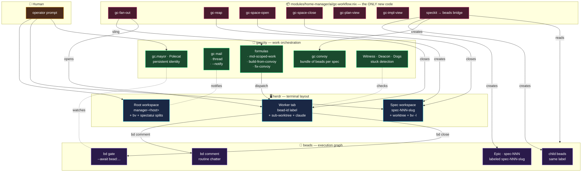

# gc-workflow — Plan

Status: proposed
Reads: [spec/gc-workflow.md](../spec/gc-workflow.md), [memory/constitution.md](../memory/constitution.md), [docs/intent/gc-workflow.md](../docs/intent/gc-workflow.md)

## 1. Architecture — three layers, one manager tree



**Rule**: every new arrow is either herdr-facing (opens/closes/labels) or
speckit-bridge-facing (reads `plan.md`, writes to beads). No new arrow
touches gc's dispatch/feedback/merge substrate.

## 2. Module layout

```text
modules/home-manager/ai/gc-workflow.nix        # home-manager module
modules/home-manager/ai/gc-workflow/
  ├── gc-fan-out.sh                             # v1 shipped
  ├── gc-reap.sh                                # v1 shipped
  ├── plan-view.sh   → gc-plan-view             # v1 shipped
  ├── impl-view.sh   → gc-impl-view             # v1 shipped
  ├── gc-space-open.sh                          # v2 — do-ve3.7
  ├── gc-space-close.sh                         # v2 — do-ve3.8
  ├── speckit-to-beads.sh                       # v3 — do-ve3.9
  └── lib/
      ├── herdr.sh                              # shared helpers
      └── bd.sh                                 # shared helpers

docs/intent/gc-workflow.md                     # v1 shipped — intent contract
spec/gc-workflow.md                            # this feature — WHAT
plan/gc-workflow.md                            # this feature — HOW (this doc)
CLAUDE.md                                       # v1 shipped — has gc-workflow section
AGENTS.md                                       # to mirror (do-ve3.11)
```

## 3. Contracts per tool

### gc-plan-view — v1 shipped

- **Input**: current herdr pane's workspace (auto-detected via
  `herdr pane current`); optional `--project PATH`.
- **Output**: right-split pane labeled `spectatui-<repo>` running
  `spectatui -p <PATH>`.
- **Idempotence**: reuses an existing `spectatui-<repo>` pane when one
  exists in the same workspace.

### gc-impl-view — v1 shipped

- **Input**: same as `gc-plan-view`.
- **Output**: down-split pane labeled `bv-<repo>` running `bv`, placed
  below `spectatui-<repo>` if it exists, else below the manager pane.

### gc-fan-out — v1 shipped

- **Input**: `--workspace ID`, `--prefix STR`, `--cap N`, `--watch SECS`
  (see `--help`).
- **Behaviour**:
  1. Auto-invoke `gc-impl-view` and `gc-reap` (both suppressible).
  2. Rename the invoker pane to `manager-<repo>`.
  3. For each ready bead matching filter: create a herdr tab labeled
     with the bead id, spawn a claude agent, sling the bead, prompt
     the agent with its assignment.
  4. In `--watch N` mode, loop: reap → fan-out → sleep.
- **Non-goal**: does NOT open a spec workspace (that's `gc-space-open`).

### gc-reap — v1 shipped

- **Input**: `--workspace ID`, `--prefix STR`.
- **Behaviour**: iterate tabs; if a tab's label matches a bead id and
  that bead is `CLOSED` and no agent in the tab is `working`, close the
  tab.

### gc-space-open — v2 (do-ve3.7)

- **Input**: `--spec <slug>` (e.g. `002-async-daemon-cqrs`), `--repo
  PATH` (default: `pwd`).
- **Behaviour**:
  1. If workspace labeled `spec-<slug>` exists → focus it and exit.
  2. Otherwise:
     - `git worktree add ../<repo>-spec-<slug> spec-<slug>` (create the
       branch if it does not exist).
     - `herdr workspace create --label spec-<slug>`.
     - Create the first tab, split right with `bv -l spec-<slug>`.
     - Start a claude agent in the first tab, named
       `spec-manager-<slug>`, prompted with a spec-manager instruction
       (points at `spec/<slug>.md` + `plan/<slug>.md` + the bead epic).
  3. Emit the new workspace id on stdout.

### gc-space-close — v2 (do-ve3.8)

- **Input**: `--spec <slug>`; optional `--watch` to run continuously.
- **Behaviour**:
  1. Look up the epic bead for `spec-<slug>` (via label).
  2. When the epic status is `CLOSED` (or all children are `CLOSED`):
     - Reap remaining worker tabs (via `gc-reap`).
     - Prompt the spec-manager pane (via `herdr agent prompt`) with the
       merge question — the spec-manager relays the choice to the human
       and executes it.
     - Close the herdr workspace.
     - Prune the worktree (`git worktree remove <path>`).

### speckit-to-beads — v3 (do-ve3.9)

- **Input**: `--plan PATH` (e.g. `plan/gc-workflow.md`), `--slug STR`,
  `--repo PATH`.
- **Behaviour**:
  1. Read the plan; extract task-shaped headings and section leaves.
  2. Create an epic bead (or reuse the existing one from `--epic`).
  3. For each task-shaped item, `bd create --parent=<epic>
     --labels=spec-<slug>`; add dependency edges from plan order.
  4. `gc convoy create '<slug> impl' <bead ids...>` for the fan-out
     target.

## 4. Data / state

### 4.1 herdr labels

| Object | Label shape | Owned by |
|--------|-------------|----------|
| workspace | `spec-<NNN>-<slug>` (spec) / free-form (root) | `gc-space-open`, human |
| tab | `<bead-id>` (worker) / `manager-<repo>` / `spec-manager-<slug>` | `gc-fan-out` / `gc-space-open` |
| pane | `spectatui-<repo>` / `bv-<repo>` / `bv-<slug>` | `gc-plan-view` / `gc-impl-view` |

### 4.2 beads labels

- Every spec's beads carry `spec-<NNN>-<slug>` (auto-tagged by the
  bridge; enforced by `bd lint` under v3.1).

### 4.3 git branches / worktrees

```text
<repo>/                            main
../<repo>-spec-<slug>/            branch: spec-<slug>
../<repo>-spec-<slug>-<bead>/     branch: spec-<slug>-<bead>
```

## 5. Cross-tool integration matrix

| Concept | gc primitive | This workflow's use |
|---------|--------------|---------------------|
| Manager persistence | `Polecat` role | Root claude + spec-manager claudes are Polecats |
| Per-spec grouping | `gc convoy` | One convoy per spec, holds all its beads |
| Worker dispatch | `gc sling --on mol-scoped-work --nudge` | Per bead, invoked by `gc-fan-out` |
| Worker branch mgmt | `mol-scoped-work` steps | Worktree + implement + submit |
| Feedback (chatter) | `bd comment` | Worker → spec-manager |
| Feedback (blockers) | `bd gate` + `gc mail --notify` | Worker → spec-manager (routine) / human (urgent) |
| Stuck detection | Witness / Deacon watchdogs + `gc escalate` | Automatic; workflow is unaware |
| Merge inside spec | `mol-scoped-work` submit step | Handled by gc |
| Push at spec-done | Human choice via `gc-space-close` prompt | Only human decision point |
| Refinement | `fix-convoy` when applicable | Optional; automatic follow-up beads |

## 6. Constitution alignment

- **§1 Declarative or bust**: the module is a `.nix` file; every
  script is `pkgs.writeShellApplication` — reproducible, shellcheck-gated.
- **§2 One flake, many modules, explicit imports**: registered via
  `modules/home-manager/ai/default.nix`; no side-effects until imported
  by a home config.
- **§3 Secrets never touch the store**: no secrets involved.

## 7. Risks & fallbacks

- **Nix packaging path leak**: fixed in v1.1 (sibling-tool resolution
  via `command -v`); documented in the script.
- **bv unable to filter by label**: verified — `bv -l <label>` works
  (subagent 2's audit); fall back to `bv --search <slug>` if the label
  doesn't resolve.
- **Formula divergence**: if `mol-scoped-work` changes its "submit"
  contract, only `gc-space-close` and the merge integration break; we
  wrap the formula call in a versioned helper.
- **Workspace explosion**: if the human accumulates many stale spec
  workspaces, the auto-close on epic-close is the main mitigation. Add
  a `gc-space-list --stale` reaper as future hygiene.

## 8. Rollout

| Step | Bead | Priority |
|------|------|----------|
| v1 delivered — 4 base scripts + nix module + intent doc + CLAUDE.md | ~~do-ve3~~ (closed) | P2 → done |
| v2 — `gc-space-open` | do-ve3.7 | P2 |
| v2 — `gc-space-close` | do-ve3.8 | P2 |
| v3 — speckit → beads bridge | do-ve3.9 | P2 |
| v3.1 — label enforcement | do-ve3.10 | P3 |
| hygiene — mirror to `AGENTS.md` | do-ve3.11 | P3 |
| hygiene — Nix build smoke check | do-ve3.12 | P3 |
| new — refine beads to reflect this plan | see §9 | P2 |

## 9. Beads decomposition

The six existing follow-ups map cleanly onto this plan. Two additions
this spec surfaces:

- **do-ve3.13** — shared `lib/{herdr,bd}.sh` extracted from the four
  v1 scripts, so v2 and v3 tools reuse the helpers.
- **do-ve3.14** — spec-manager prompt template (spec-manager instruction
  block, similar to the worker prompt template already used by
  `gc-fan-out`).

These are filed alongside the existing beads under `do-ve3`.
